**The first chapter of a study of banking in the Twin Cities.** Synthesis report, written 2026-11-11 from the module memos in `modules/`, their red-team reviews in `review/`, and `plan/discoveries.md`. Data run through the third quarter of 2026; market prices to 2026-11-09.

Companion deliverables: two-page brief (`report/usb_brief.md`), slide deck (`report/usb_slides.md`), master timeline (`report/usb_timeline.md`), promises-versus-outcomes scorecard (`report/usb_promises_scorecard.md`), network map (`report/usb_network_map.md`), consolidated open-questions list (`report/usb_open_questions.md`).

**Updated 2026-11-11.** This version adds data that arrived after the first draft. Three sets were added: the FR Y-9C holding-company reports for 2021Q2 to 2026Q3; the CRA small-business lending files for 1996 to 2025; and licensed data through WRDS (CRSP stock returns, LSEG I/B/E/S analyst forecasts, FINRA TRACE bond trades, Mergent FISD ratings, LSEG 13F holdings and Revelio Labs workforce data). Thirteen module memos were updated, and two change lists record every number that moved (`review/update_2026-11-11_y9c_cra.md`, `review/update_2026-11-11_wrds.md`). In the chapter 1 table, eight of the eleven findings changed. Findings 1 and 4 now use the holding-company Y-9C basis. Findings 5 and 7 add Revelio workforce data. Finding 8 adds small-business lending. Finding 9 now measures the Twin Cities share of the bank's jobs. The last two findings add analysts' forecasts and total returns to the valuation, and drop a gap that the new data partly filled. Findings 2, 3 and 6 (fees and funding, accounting, conduct) did not change. The text behind them changed in chapters 3 to 6. In Appendix C the verdicts on H3, H6, H8 and H22 changed while H4 and H5 gained evidence. Licensed WRDS data appear only as derived statistics, cited as, for example, "CRSP via WRDS"; no rows of the licensed files are reproduced.

---

## How to read this report

**What it is.** An outside, public-records teardown of U.S. Bancorp (the holding company, called USB here) and its bank, U.S. Bank National Association (called the bank). It is not investment advice and gives no price target or recommendation.

**Where the numbers come from.** Every figure in this report was first produced in a module memo, where it is traced to a source document (a source id from `sources.csv` with a page, table or field) or to the script under `code/` that computed it. This report prints each number exactly as the memo printed it. The file `report/usb_report.evidence.csv` lists, for every number in the report, the memo row that backs it, and `code/synthesis/build_report_ledger.py` rebuilds that list. Module citations appear in square brackets: **[C]** means the finding comes from `modules/c_financial.md` and its review. The key to the letters is in Appendix A.

**Four labels.** Each claim carries one of four labels, so that a reader can always tell what kind of statement it is:

- _(fact)_: reported in a source document, such as a 10-K, a regulatory filing or an enforcement order.
- _(calc)_: a calculation from reported facts, by a named script.
- _(est)_: an estimate from a model, with its method and uncertainty stated.
- _(interp)_: interpretation, ours or a memo author's. Interpretations are kept in their own sentences.

Where a red-team review weakened or corrected a memo's finding, this report uses the reviewed version and says so where it matters. Allegations in lawsuits and complaints are described as allegations. Enforcement orders entered by consent are described as findings in a consent order, "without admitting or denying", unless the bank stipulated the facts.

**Confidence.** **High** means the number is checked and the reading has no serious rival. **Medium** means the number is sound but its interpretation has a credible alternative, or rests on one data source. **Low** means the direction is uncertain or the method is weak. Descriptive results are called descriptive. Nothing about U.S. Bancorp alone is presented as a causal finding, because with one firm there is no comparison group; causal designs in this project use panels of many banks, counties or metros.

**Terms.** Banking terms are defined on first use and collected in the glossary in Appendix B.

---

## 1. Executive summary: the things a reader must know

**The argument in one paragraph** _(interp)_. U.S. Bancorp is a national bank with a Minneapolis head office, a Cincinnati charter and an unusually large fee business in corporate trust and payments. For two decades its reputation rested on three advantages: the highest returns among its peers, the lowest cost per dollar of revenue, and cheap deposits. By the mid-2020s all three had converged to the peer average or reversed; the holding company still earns a little more than peers on tangible equity, but only because that equity is thinner. Part of the old advantage was leverage (thin equity) and part was cheap funding that disappeared when interest rates rose; the cost advantage turned into a disadvantage that is mostly about how many people the bank employs per dollar of assets. What remains distinctive is the fee franchise and a funding base that leans on large institutional and uninsured balances. Those two features explain much of the rest of the record: why its Twin Cities deposit share looks dominant while most of it sits in two downtown booking offices that probably hold national balances; why its balance sheet was more exposed than most peers' in 2022-23; and why its largest conduct failure, in anti-money-laundering controls, is documented as a resourcing decision. The accounting is clean and roughly neutral. The labor record is lean but not exploitative on the evidence available; new employer-level profile data add detail but are still descriptive. Shareholders have done much worse than at peers since 2016, after doing better over the longer run. The headquarters matters to Minneapolis in visible ways (the head office, the board, the tower, the stadium name), and on profile data the bank employs about three in ten of the metro's commercial-bank workers. But its weight as a local deposit-taker and lender is smaller than the headline deposit share suggests, and its wider economic weight is harder to pin down than either its critics or its boosters assume.

The numbered findings below each have a confidence level. Each is supported in the chapter named.

| # | Finding | Confidence | Where |
|---|---|---|---|
| 1 | **The famous performance edge has narrowed to a thin, leverage-driven lead at the holding company and a small deficit at the bank.** On the bank-level basis the gap between USB's return on tangible common equity and the median of its five closest peers was 20.85 points in 2005, 7.58 in 2015, 3.94 in 2019 and -1.89 in 2024 _(calc)_. On the holding-company basis, now built from the FR Y-9C with one definition for every bank, the gap was 17.99 in 2005, +1.41 in 2024 and +2.70 in 2025, rank 3 and 2 of 12 in the last two years _(calc)_. That lead comes from thin equity: leverage contributes +3.22 and +3.56 points and margin -4.19 and -6.49, and on return on assets, which removes leverage, USB ranks 9 and 5 of 12 _(calc)_. The bank-level efficiency ratio (cost per dollar of revenue; lower is better) went from 45.1 against a peer median of 61.4 in 2005 to 61.0 against 56.9 in 2024, rank 10 of 12; at the holding company it was 58.9 against 59.5 in 2025, about the median _(calc)_. Net interest margin was last of 11 in 2025 _(calc)_. | High that it narrowed; medium on the holding-company sign (positive, leverage-driven) | 3.1 [C] |
| 2 | **What remains distinctive is fees and an institutional funding base.** Fees were 40.2% of bank-level revenue against a peer median of 27.2% in 2025 _(calc)_. The bank is first of 117 reporting banks in corporate trust on both issues and principal _(calc)_. But its share of deposits that pay no interest fell from 29.1% to 16.1% between 2021Q4 and 2024Q4, tenth of 11 peers every quarter since 2017Q1 _(calc)_, and its estimated uninsured deposit share, 53.1% at 2026Q2, is the highest of 11 _(calc)_. | High (fees); medium (deposits, trust rank) | 3.1, 3.2 [C, N] |
| 3 | **The accounting is clean and roughly neutral, not conspicuously conservative.** No restatement or material weakness in any 10-K _(fact)_. Reserves were high relative to loans but covered later losses at about the peer median in the financial crisis and below it, though not in the bottom quartile, in 2011-2019 _(calc)_. The 2019 and 2022 moves of securities between accounting categories were shared by peers; only the late-2021 timing stands out, and its motive cannot be observed _(interp)_. "One-time" items recur, and those management flags lean 3.8:1 toward excluding charges rather than gains _(calc)_. Union Bank purchase-accounting income was about 1.9% of 2023 net interest income _(fact; calc; the fourth quarter is company guidance)_, so purchase accounting did not flatter 2023 GAAP earnings. | Medium-high | 3.3 [B, BC] |
| 4 | **Capital was run lean, then the Union Bank deal and the 2022 rate shock exposed the balance sheet.** Holding-company CET1 (the main regulatory capital ratio) was the lowest of 11 at every year-end 2015-2020, and on the Y-9C, which now covers all ten peers, it was below the ten-peer median at every year-end 2015-2025 except 2021 (lowest of 11 in 2022; -0.08 points, rank 8 of 11, in 2025) _(calc)_. At 2026Q3 it was above the median, 10.83 against 10.39, rank 4 of 11 _(calc)_. After moving $45.1 bn of securities into held-to-maturity in 2022, the unrealized loss on that book was -32.5% of tangible equity at 2022Q4, second worst of 11 _(calc)_. In the March 2023 bank scare the stock fell -27.6% against a peer median of -19.0% (nine peers; -22.0% on a ten-bank set) _(calc)_; across 270 listed banks its size and uninsured share predict most of that fall (CRSP via WRDS) _(est)_, and its bond spreads widened less than peers' (TRACE via WRDS) _(calc)_. The bank took a $1.0 billion one-day Federal Reserve term-funding advance that its quarterly report did not mention _(fact)_. | High on facts; medium on the reading | 3.4 [C, P, O, Z] |
| 5 | **Labor: historically lean, now ordinary; no original causal labor result survived review, including on new employer-level data.** USB's labor share of value added averaged 29.5% against a peer median of 41.5% in 2001-2007, the lowest in the group in that period _(calc)_, and its headcount follows revenue more closely than at any of 15 large banks _(est)_. Real pay per employee went from first among peers before 2001 to about the median after _(calc)_. Disclosed median employee pay rose 24.5% in real terms FY2017-FY2025, more than the peer median or the CEO's pay _(calc)_. Rate-driven swings in profit show no detectable pass-through to average pay _(est)_. On Revelio profile data (via WRDS), USB's modelled starting salary for the same job is at par with the regional-peer median and below the largest banks, and its staff leave a little less often than peers' _(est)_. These are modelled salaries and profile-based counts, not payroll. Rebuilt on that employer panel, the noncompete test still cannot detect plausible effects _(est)_. All the new labor results are descriptive (Chapter 3.5). | Medium | 3.5 [F, F-local] |
| 6 | **The largest conduct failure is documented as a resourcing choice; the evidence that incentive pay drove misconduct is limited to one consumer order.** In the 2018 anti-money-laundering case the bank stipulated that it "capped the number of alerts generated by its transaction monitoring systems based on staffing levels and resources" _(fact)_. The cash cost was $613M _(calc)_. Only the 2022 consumer-bureau sales-practices order (penalty $37.5M) contains an incentive finding _(fact)_, and no named-executive pay metric in 25 proxies rewarded account growth or cross-selling _(fact)_. Hypothesis H15 (conduct traces to incentive design visible in proxies) is weakened. | High on documents; medium on the cultural reading | 3.6 [H, I] |
| 7 | **Union Bank: cheap to buy, costly to hold through 2023, and not shown to have destroyed value.** Promised tangible-book dilution of about 1% became about 11% _(fact)_; merger charges ran 24% over the announced estimate _(calc)_; the $900 million of cost savings was reported met _(fact)_. Combined headcount fell by at least 8,419 (11.4%) net of what the seller kept _(calc)_, inside the range seen after other large mergers _(est)_. Profile data (Revelio via WRDS) place the fall mainly in California, where the group's headcount changed by -15.3% against -6.2% at the four largest banks in the state, but the front-line retention promise is still not verifiable _(calc)_. Whether the deal paid off for shareholders is undeterminable, leaning toward "it did not destroy value" (H14 leaning rejected). The $100 billion community plan is a private pledge that the OCC says it "does not monitor compliance with nor enforce" _(fact)_. | Low-medium | 3.7 [UB, E, F, V] |
| 8 | **The headline Twin Cities deposit share is concentrated in two booking offices whose balances are probably national** _(interp; no source says what they hold)_. USB reports 41.1% of metro deposits, but 85.1% of its metro deposits sit in two downtown offices _(calc)_. Excluding very large offices its share is 14.6%, about where it was in 1994 (14.9%) _(calc)_. On a constant definition its share of local mortgage originations fell from 12.1% (2011, a peak) to 2.2% (2025) _(calc)_. Its share of metro small-business loan dollars fell from 35.8% (1996) to 8.6% (2025) while its deposit share outside booking offices went from 15.3% to 14.6% _(calc)_. Its home-market deposit position does not look like a pricing-power franchise that subsidizes the national businesses (H7 not supported where testable). | High on numbers; medium on what the booked balances are | 4.2 [G, M] |
| 9 | **The headquarters is visibly anchored in Minneapolis and is a large local employer, but its wider economic weight is uncertain.** Excluding offices that came from Union Bank, Minnesota branches were cut less than in any other large state _(calc)_ and the downtown head-office lease was renewed in 2023 _(fact)_. On Revelio profile data (via WRDS), USB had 11,682 employees in the metro in December 2019, 31.4% of the metro's commercial-bank jobs _(est)_. The Twin Cities share of its U.S. headcount rose from 16.9% (2010) to 19.6% (2020), fell mechanically when Union Bank was added, and was 16.6% in 2025 _(est)_. So H3 (a falling Twin Cities share of the firm's jobs) is not supported on total headcount, although within the same kinds of job the share fell by 0.09 points a year _(est)_. A cross-metro study of headquarters losses finds no detectable effect on local bank employment, with a ten-year interval of -6.8% to +9.5% and a sign that changes with the sample _(est; low)_, the board's ties to other Twin Cities public companies fell from 5 to 2 _(calc)_, and foundation grants run below the peer median relative to profit _(calc)_. | Medium on the jobs share (profile data); low-medium on the rest | 4 [T, F-local, Z, R, V] |
| 10 | **Valuation: priced like an ordinary regional bank, with a small book-value premium that is mostly an accounting effect; shareholders have lagged peers since 2016.** Trailing price-to-earnings 11.9 against a peer median of 11.8, and 11.0 against 10.9 on analysts' forward earnings (I/B/E/S via WRDS); price to tangible book 2.13 against 1.90, but 1.76 against 1.64 excluding unrealized securities losses _(calc)_. The price-to-tangible-book premium over the 14-peer median fell from 61% (2016Q4) to 8% (2026Q3), a decline sensitive to acquirer peers _(calc)_. On consensus forward returns, the measure the study design called for, USB sat below its return-adjusted line in 2025 (-14.6% at 2025Q1) and on it at 2026Q3 (0.3%), inside the 90% prediction interval in all 40 quarters; whether it trades below what its returns justify is still not established _(calc)_. With dividends reinvested, USB returned 60.8% from 2016-11-09 to 2025-12-31 against a peer median of 177.9%, last of ten, after beating the median from 1990 to 2025 (11.7% a year against 9.9%) (CRSP via WRDS) _(calc)_. The share price implies a return on tangible equity of about 14.0% (excluding securities losses) held indefinitely _(calc)_, or, on analysts' forecasts with fading returns, a cost of equity of 9.0% against a regional median of 9.6% _(est)_; our normalized estimate is 16.0%, 13.3% excluding those losses _(est)_. | Medium | 5 [E, P, BC] |
| 11 | **Some of the most important questions cannot be answered from outside.** What the two booked deposit offices actually hold; Union Bank's stand-alone earnings; paid wages by employer and worker (licensed profile data now give employer headcount by place and modelled salaries, not payroll); where the foundation's money and the tax-credit projects go; and why the headquarters stayed in Minneapolis in 1997 and 2001. Each has a named dataset or records request that would resolve it (Chapter 6). | High (as a statement of the gaps) | 6 |

**What changed from the conventional account** _(interp)_. Three widely repeated beliefs about this bank did not survive the evidence: that it is still the industry's efficiency leader (it was, through 2016; it is not now); that its home deposit base is a dominant local franchise (most of it sits in two booking offices and is probably not gathered locally); and that its reputation for conservatism is a reputation for conservative accounting and reserving (the accounting is clean, but reserves track peers, capital was the thinnest in the group for six years, and the securities book was among the most exposed in 2022). One unflattering belief also did not survive: the record does not show that its headcount cuts after Union Bank were unusually deep for a merger of that size. The new data settle two more points [P, F-local]. The stock's "lower-return" reputation since 2016 holds on total returns as well as on prices, although over the longer run it beat its peers. And the common worry that jobs were drifting away from the head office does not hold on total headcount: the Twin Cities did not lose share of the firm's jobs between acquisitions, though it lost share within the same kinds of job.

---

## 2. The institution in one chapter

**Conclusion first** _(interp)_ [A]: U.S. Bancorp is a holding company whose economic substance is a single national bank chartered in Cincinnati, run from Minneapolis, assembled from 59 absorbed charters, and distinctive for earning about two-fifths of its revenue from fees, much of it in businesses (corporate trust, payments, wealth) that generate large institutional deposits.

### 2.1 What it is

**The bank is the firm.** U.S. Bank National Association held 97.7% of consolidated assets at the end of 2024, and the ratio stayed between 97.2% and 99.1% at every year-end 2008-2025 except 2022 _(calc)_ [A]. On the Y-9C at the end of 2025 the ratio was the lowest of the eleven non-money-center banks, though still within a point of the others _(calc)_ [A]. The holding company has "no executives, key employees, or critical services of its own", according to its resolution plan _(fact)_ [A] (boardofg-a8dd0df7b7). For income the bank is a weaker proxy: its net income ranged from 94.3% to 114.4% of consolidated _(calc)_ [A].

**Its legal home is Cincinnati; its management home is Minneapolis.** The bank operates under national charter 24 (1863), with its main office at 425 Walnut Street in Cincinnati _(fact)_ [A]. In 2001 the Minneapolis U.S. Bank charter, then $80.5 billion of assets, was folded into the Firstar/Star Bank charter ($76.4 billion), which took the U.S. Bank name; 59 distinct charters have been absorbed since 1991, 14 of them FDIC-assisted _(calc)_ [A]. The filings do not say why the Cincinnati charter was chosen _(fact)_ [A]. The holding company's executive offices and board are in Minneapolis, at 800 Nicollet Mall [T].

**Employees** _(fact)_: 68,520 at the end of 2025 by the 10-K's company-wide count (sec-3ece816825) [S]. The regulatory (Call Report) count of full-time-equivalent staff at the bank was 65,974 [A]. These definitions differ and are not reconciled in the filings.

**Structure of the business** _(fact)_ [D]. USB reports segments for Wealth, Corporate, Commercial and Institutional Banking; Consumer and Business Banking; Payment Services (card, corporate payments and merchant acquiring under the Elavon name); and Treasury and Corporate Support, which is a residual. Segment profit is a poor guide to what each business earns: two recasts of segment results moved about $1,263 million of 2023 net interest income out of Treasury into the operating segments without a stated reason _(calc)_ [D], and the managerial tax rate charged to segments changed from 36.4 percent to 25.0 percent in FY2018 _(fact)_ [D].

### 2.2 How it makes money

A bank makes money in two ways: **net interest income**, the difference between what it earns on loans and securities and what it pays on deposits and borrowings; and **noninterest (fee) income**, from services. **Net interest margin** (NIM) is net interest income divided by interest-earning assets.

**Fees are the distinguishing feature.** On the holding-company basis, fee income was 41.7% of revenue in 2025 against a peer median of 29.0%, and the gap to peers has widened, not narrowed: 12.6 pp in 2025 against 7.4 pp in 2010 _(calc)_ [D]. Within fees, the lead bank's trust (fiduciary) income is 19.1% of noninterest income against 11.8% at core peers, while deposit service charges are 10.9% against 21.6% _(calc)_ [D]. Payments (card, corporate payment and merchant processing) are 36.1% of noninterest income _(calc)_ [C].

**The engines, one by one** [N]:

- **Corporate trust** is the clearest leader. The bank reported 158,670 corporate and municipal trusteeship issues and $6,899 billion of principal at year-end 2025, first among 117 reporting banks on both measures _(calc)_ [N]. A trustee administers bonds on behalf of investors: collecting and paying out cash, and holding it in the meantime, which is one reason trust businesses generate deposits.
- **Payment Services** has grown slowly and now earns less on its capital. Net revenue rose from $4,740 million (2012) to $7,407 million (2025), 3.5% a year _(calc)_; return on allocated equity fell from 22.5% (FY2021) to 10.2% (FY2024) before recovering to 12.4% (FY2025) _(fact)_ [N, D]. The fall from 2021 is mostly provisions for card losses rising from a low base, not lost revenue _(calc)_ [C]. Merchant processing revenue per dollar of card volume fell from 59.8 bps to 40.9 bps (2012 to 2025) _(est)_ [N].
- **Trust and investment management fees** grew from $1,055 million (2012) to $2,869 million (2025), 8.0% a year, with about half of the 2022 step explained by the end of money-market fee waivers _(calc)_ [N].
- **Card lending**: average card balances $30,093 million in 2025; card net charge-offs 3.9%, fourth of six large card lenders _(calc)_ [N].
- **Mortgage banking** revenue fell from $1,937 million (2012) to $645 million (2025) _(fact)_ [N]; 2012 was a refinancing boom, so the fall overstates any decline in the franchise _(interp)_.
- **Tax-credit investing** (affordable housing, renewable energy) is large on the balance sheet: carrying value of unconsolidated vehicles $9,712 million at end-2025 _(fact)_ [N, B]. It lowers the tax bill by an amount equal to 4% to 12% of after-tax profit in most years, but credits and the related investment write-downs nearly cancel, so its net profit contribution is small (net $44 million in 2025) _(calc)_ [N, W, X].

**The deposit side.** About two thirds of the bank's noninterest-bearing deposits sit in the wholesale and institutional segments; most of the rest is in Consumer and very little in Payment Services _(calc)_ [C]. The trust, escrow and payments components are not disclosed separately _(fact)_ [C]. This matters for the home-market question in Chapter 4.

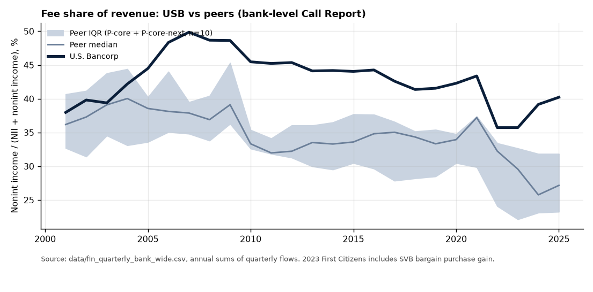

### 2.3 How it got here

**Conclusion first** _(interp)_: the firm is the product of a series of mergers in which the Minneapolis side kept the headquarters while the name, the charter and much of the senior management came from elsewhere; its cost discipline arrived in the 1990s rather than being an old Minneapolis trait; and its crisis record is good in 2008-2012 and poor in 1986-1991.

- **The lineages** _(fact)_ [K]. First Bank System (Minneapolis) bought Metropolitan Financial in 1995 and merged with the old U.S. Bancorp of Portland in 1997, taking the U.S. Bancorp name. Firstar (Milwaukee, itself formed by Star Banc of Cincinnati) merged with U.S. Bancorp in 2001. In each merger of equals the prizes were split: in 1997 Minneapolis got the headquarters, the legal survivor and the CEO, Portland the name and the chair; in 2001 Minneapolis got the headquarters, the legal survivor and the name, Milwaukee the CEO and 14 of 25 board seats _(fact)_ [K] (sec-32ef5e11fd; sec-7f634ccba8). Neither filing says why Minneapolis kept the headquarters _(fact)_ [K].
- **The cost culture was imported, or at least arrived late** _(calc; interp)_ [K]. First Bank System's efficiency ratio was above the peer median in six of eight years 1986-93 and durably below it only from 1994, four years after John F. Grundhofer became CEO in 1990. The memo shows the timing, not the mechanism.
- **The 1980s were not conservative** _(calc)_ [K]. In 1986 First Bank System's net charge-offs were 2.56% of loans, 4.3 times the median of large peers; it lost $347.3 million in 1988, mostly on securities, and kept paying dividends through the distress.
- **2008-2012 was a good crisis** _(fact; calc)_ [K, U]. USB stayed profitable every year (minimum return on assets 0.78% in 2009), took $6,599,000,000 of TARP capital on 2008-11-14 and repaid it at par on 2009-06-17, and cut its quarterly dividend from $0.425 to $0.05 in 2009Q1, a cut matched or exceeded by 5 of 10 peers.
- **The modern period** _(fact)_ [K, H, UB]: the 2011 mortgage-servicing orders, the 2015 and 2018 anti-money-laundering actions, the 2021 agreement to buy MUFG Union Bank (closed 1 December 2022), the 2022 and 2023 consumer orders, and a CEO succession in April 2025 (Gunjan Kedia, who joined from State Street in December 2016) [R].

The full dated record is in the master timeline (`report/usb_timeline.md`).

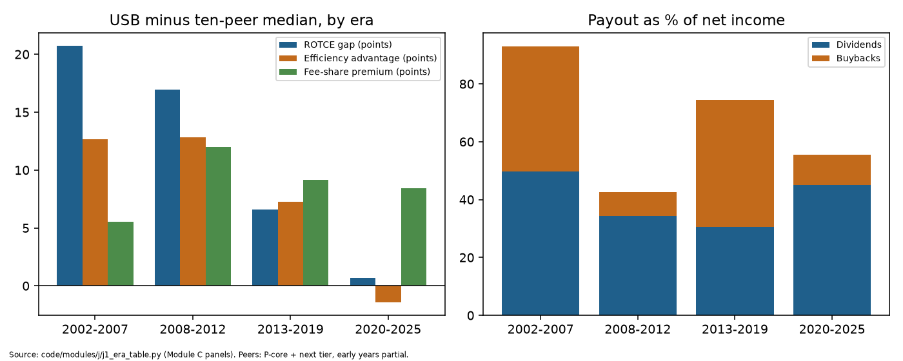

---

## 3. The integrated analysis

This chapter is organized around the questions that connect the modules (`plan/research_design.md` section 8), not around the modules themselves. Each section opens with its conclusion.

### 3.1 The edge, and where it went

**Conclusion** _(interp)_ [C, D, J]: USB's above-peer returns came from three sources: a fee franchise, low costs, and thin equity. Low costs have gone and the margin has turned into a large drag. The fee franchise remains. At the holding company, thin equity is now what keeps return on tangible equity a little above the peer median; at the bank, where equity is measured differently, the gap is slightly negative. The decline was gradual and began around 2008-2011, well before the Union Bank deal, so the deal did not start it; whether the deal deepened the negative gap of 2022-24 is not tested.

**Return on tangible common equity (ROTCE)** is profit to common shareholders divided by their equity excluding goodwill and other intangible assets. On the bank-level (Call Report) basis, USB's gap to the median of its five core peers (Capital One, PNC, Truist, Fifth Third, Huntington) was 20.85 points in 2005, 7.58 in 2015, 3.94 in 2019 and -1.89 in 2024; USB ranked 1, 1, 2 and 7 of 12 _(calc)_ [C]. The review of Module C corrected these figures after finding that one intangible-asset item stops in 2018 and had been filled with zeros; the numbers above are the corrected ones.

**The holding-company basis** _(calc)_ [C]. The FR Y-9C now runs to 2026Q3, so the holding-company return can be built with one definition of tangible equity for every bank. On that basis USB's gap to the P-core median was 17.99 points in 2005, 6.13 in 2015, 3.86 in 2019, +1.41 in 2024 and +2.70 in 2025; it ranked 3 and 2 of 12 in the last two years. Against the wider ten-peer median the 2024 and 2025 gaps are 3.06 and 4.17. In 2022 and 2023, the Union Bank years, the gap was -2.42 and -0.06. The two bases agree on the long decline. They disagree on today's sign because of equity, not earnings (below).

**What carries the holding-company lead today** _(calc)_ [C]. In 2024 and 2025 margin contributed -4.19 and -6.49 points to the gap, fees 6.61 and 5.71, and leverage +3.22 and +3.56. USB runs more assets per dollar of tangible equity than its peers (19.07 times in 2024, partly because securities losses reduce equity). On return on assets, which is free of leverage, it ranked 9 and 5 of 12: 0.94 against a P-core median of 0.99 in 2024 and 1.10 against 1.03 in 2025. _(interp)_ The lead is real on the measure shareholders see, but it comes from thinner equity rather than better earnings, so it is more fragile than the rank suggests.

The narrowing is a long decline, not a break. The gap averaged 8.19 points over 2012-16 _(calc)_ [C]. A consistent treatment of mortgage servicing assets in bank-level tangible equity would make it 7.18, and the 2005 gap 17.94 rather than 20.85; the direction of every finding stands _(calc)_ [C]. A statistical test for a single break dates one after 2011, but on a trending annual series of this length it cannot distinguish a break from a trend _(calc)_ [C]. The gap was still 3.74 points in 2020 and 4.35 in 2021, before the Union Bank announcement _(calc)_ [C].

**Where the advantage came from** _(calc)_ [J, D]. Splitting the gap by era, about 9 of the 20.7-point gap in 2002-2007 was leverage: tangible equity was 5.02% of assets at USB against 6.70% at peers [J]. On a return-on-assets basis (which removes leverage) the premium averaged 0.34 pp in 2010-2021, built from fees (0.58 pp) and lower noninterest cost (0.28 pp), partly offset by lower net interest income (-0.49 pp) [D]. That decomposition fits hypothesis H12 (returns come from fees and cost discipline rather than lending or deposits) for 2010-2021; the memo itself gives no formal verdict, so this is our reading _(interp)_. For 2022-2025 the return-on-assets gap averaged -0.05 pp, a 2022 trough (-0.30) followed by small positive gaps in 2024 and 2025; excluding Capital One the cost advantage is zero, a low-confidence finding _(calc)_ [D].

**Efficiency reversed.** The efficiency ratio (noninterest expense divided by revenue) was 45.1 against a peer median of 61.4 in 2005, 55.1 against 60.4 in 2019, and 61.0 against 56.9 in 2024, rank 10 of 12 _(calc)_ [C]. On the holding-company Y-9C basis, which includes parent and nonbank staff, it was 44.4 against 56.7 in 2005, 62.5 against 60.3 in 2024 (rank 9) and 58.9 against 59.5 in 2025 (rank 5 of 12), so by 2025 the consolidated firm was back to about the median _(calc)_ [C]. In 2024 salaries and benefits were 1.55% of average assets against 1.25% at core peers; employees per $bn of assets were 101.96 against 93.30; and pay per FTE was $150.2 thousand against $148.7 thousand _(calc)_ [C]. Against the wider ten-peer median USB's pay per FTE is further above the median, so both headcount and pay contribute, and how much each contributes depends on the peer set _(calc)_ [C]. One adjustment makes the reversal look slightly worse: tax-credit project costs that fell out of noninterest expense hide 2.3 points of the efficiency deterioration over 2014-2022 [X]. Separately, card rewards netted against payments revenue lower the reported ratio by 3.2 to 4.1 points a year relative to a gross presentation; this is standard accounting, and peers' treatment was not compared [BC].

**Margin and fees.** Net interest margin led the group in 2002-04 and has been below the peer median every year since 2017; it was 2.80 against 3.24 in 2025, last of 11 _(calc)_ [C]. Fee-heavy banks structurally run lower margins, so the margin rank alone is not a performance ranking (Module C review). Fee income remains the one return component positive in every year examined, and on the bank-level basis fees were 40.2% of revenue against a peer median of 27.2% in 2025, first or second of 11 in every year since 2010 _(calc)_ [C].

**Credit is a mix choice.** Net charge-offs have been above the peer median in every year 2013-2025 except 2021, mainly because card is 8.0% of loans against 1.0% at peers _(calc)_ [C]. In the 2007-11 crisis cumulative losses were mid-pack (8.67% of 2007Q4 loans against a 7.90% median, rank 7) _(calc)_ [C].

**Did the market notice first?** Hypothesis H19 says the return gap narrowed before the valuation premium. The ordering fits: the raw premium shrank 2016-2021 as returns converged, while the return-adjusted premium held until 2024 and fell mainly in 2025Q1 _(calc)_ [E]. No formal break dating was done, so H19 is "consistent, not tested".

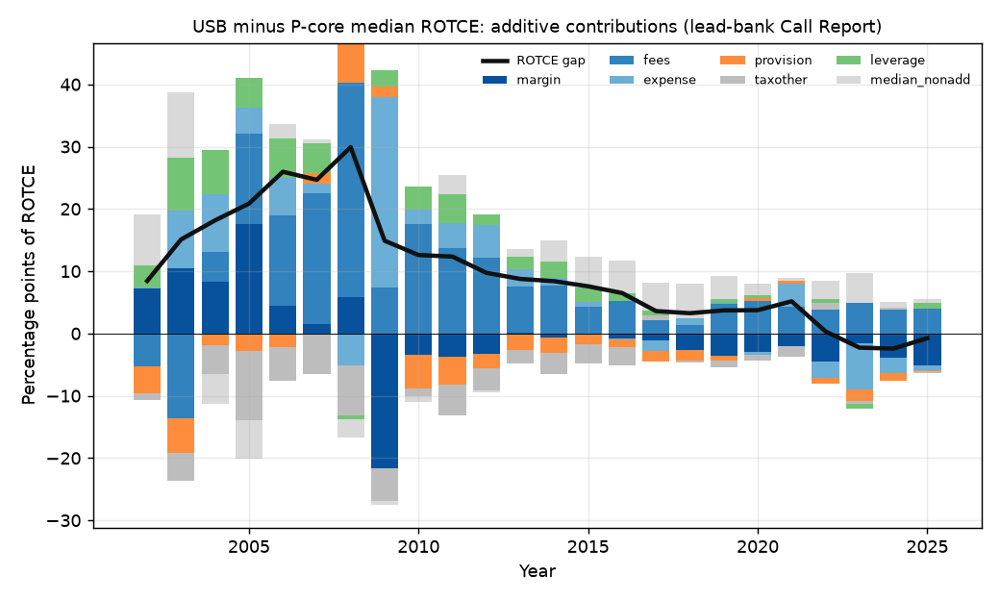

### 3.2 Funding: what the deposits are, and what they cost

**Conclusion** _(interp)_ [C, M, D, BC]: USB's cheap-deposit advantage was real before 2010 and came from paying less on interest-bearing accounts, not from an unusually large base of free deposits. It is gone. Today the bank funds itself more expensively than peers because it has fewer noninterest-bearing deposits, more uninsured institutional balances and more wholesale borrowing. The idea that a dominant home deposit franchise subsidizes the national businesses is not supported where it can be tested.

- **Cost.** USB's deposit cost was 0.56 points below the median of 14 other banks in 2007 and 0.57 below in 2009; it was +0.15 in 2019 and +0.22 in 2025, rank 12 of 15 _(calc)_ [M]. The pre-2010 advantage came mostly from lower rates on interest-bearing deposits, not from the mix of free deposits _(calc)_ [C].
- **Mix.** The noninterest-bearing share ranked first in 2003-08 and has ranked 10th of 11 every quarter since 2017Q1; it fell from 29.1% to 16.1% between 2021Q4 and 2024Q4 _(calc)_ [C]. The recent cost gap to peers is almost all mix, worth about $1,109 million of extra interest cost in 2024 _(calc)_ [C]. That split is an accounting identity, so "the penalty is mix" is arithmetic, not a cause _(interp)_ [C].
- **Rate sensitivity.** The **deposit beta** (the share of a rise in market rates that a bank passes on to depositors) was 0.45 for USB in 2022Q1-2024Q2 against a peer median of 0.40, and above the median in 2015-2019 too _(calc)_ [M]. No period shows USB less rate-sensitive than peers (Module M review).
- **Concentration and run risk.** The bank's estimated uninsured share was 53.1% at 2026Q2, the highest of 11 peers _(calc)_ [C]. Core deposits have been a lower share of funding than at nearly every peer since 2012 _(calc)_ [C]. Average daily liquidity coverage (LCR, high-quality liquid assets against 30-day stressed outflows) has been 106.5 to 109.4 percent since it was first disclosed in 2023Q4 _(fact)_ [C].
- **Where the cheap deposits come from (H16).** About two thirds of noninterest-bearing deposits sit in wholesale and institutional segments _(calc)_ [C], and the Wealth segment held 21% of average deposits in 2022 at a loan-to-deposit ratio of 0.23 _(calc; medium-low confidence)_ [D]. The only direct disclosure is that, of a $17 billion first-quarter 2023 fall in deposits, $10 billion was seasonal corporate-trust outflow _(fact)_ [C]. Trust, escrow and payments balances are not disclosed separately _(fact)_; H16 is therefore undeterminable _(interp)_ [C, BC].
- **Who absorbed the 2021-2025 rate cycle** _(calc)_ [BC]. Net interest income rose $4,165 million from 2021 to 2025. Higher deposit costs absorbed 64% of the gain from repricing assets; with the shift away from free deposits, 70%; with wholesale funding costs, 90%. The largest single source of the gain was balance-sheet growth.

**The home-market subsidy hypothesis (H7)** _(calc; interp)_ [M, G]. H7 proposed that the bank has pricing power in its home deposit market and that home deposits fund the national businesses. Each part was tested separately. H7a (cheaper, less rate-sensitive deposits) held in level in 2007-2009 but no longer holds. H7b (the advantage reflects market power rather than mix) is not supported: across 15 banks, rate sensitivity is explained by the share of free deposits, and county concentration adds nothing measurable, though with only 15 banks the test has little power. H7c (the home market is where the advantage is earned) is not supported by market structure: USB's deposit-weighted county concentration index is 1,342 in the metro against 1,475 across its footprint. H7d (home deposits fund national lending) is undeterminable. The decisive fact is in Chapter 4: most of the deposits booked in the Twin Cities sit in two head-office booking offices, probably national balances, though no source says what they are.

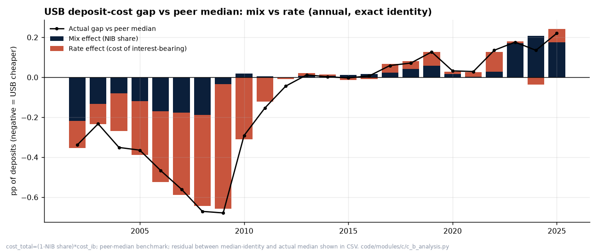

### 3.3 The accounting choices

**Conclusion** _(interp)_ [B, BC]: on every discretionary choice examined, USB looks like its peers. The accounting is clean; reserves are high relative to loans but cover later losses at about the median in the financial crisis and below it (not in the bottom quartile) in 2011-2019; the securities reclassifications were mostly an industry pattern; and the non-GAAP presentation leans, as most banks' does, toward excluding charges. The reputation for conservatism is better supported for credit underwriting in the 1990s-2010s than for accounting judgment.

- **Controls and auditors** _(fact)_ [B]. No restatement or material weakness in any 10-K; unqualified internal-control opinions FY2004-FY2025. Ernst & Young has audited the company since fiscal 2003. One episode surfaced only in SEC correspondence: in December 2006 USB told SEC staff it had applied a hedge-accounting shortcut wrongly (about $1.5 billion notional of FHLB advances) and corrected it with a cumulative Q1 2006 adjustment that management judged immaterial.
- **The allowance for credit losses** (the reserve set aside for expected loan losses) _(calc)_ [B, BC]. In 2011-2019 USB's allowance averaged 1.66% of loans against a peer median of 1.43%, but it covered the next year's charge-offs 2.84x against 3.79x, mean rank 8.2 of 11 [B]. In the financial crisis the build covered later losses at about the median (0.236 against 0.251) [BC]. A statistical test for earnings smoothing through provisions found nothing outside the crisis years [B]. By the hypothesis register's rule, H13 (the conservative reputation holds when reserves are compared with later losses) is neither supported nor rejected: coverage was below the median but not in the bottom quartile _(interp)_. The card-heavy loan mix is the main alternative explanation and was not adjusted for.
- **Securities classification.** Securities can be held as **available for sale** (AFS; marked to market, with gains and losses in equity through accumulated other comprehensive income, AOCI) or **held to maturity** (HTM; carried at cost, losses not recognized). On 31 Dec 2019 USB moved all $43.6 billion of HTM securities to AFS, citing 2019 capital rule changes; Capital One, First Citizens and Truist also had zero HTM at that quarter-end _(fact)_ [B]. It moved $43.1 billion back into HTM in Q4 2021 and $45.1 billion more in 2022 _(fact)_ [B, C]. The Q4 2021 tranche came the quarter after the Union Bank announcement and a quarter or two before most peers; it fits a capital-planning motive and equally an earlier view on rates, and the data cannot separate them _(interp)_ [BC]. B3 (transfers timed to capital rules) is therefore partly supported on timing, with motive undetermined [BC]; Module B, noting that the bank's category let it keep these losses out of regulatory capital, finds B3 not supported as a capital-timing motive for 2022 [B].
- **Union Bank purchase accounting** _(fact; calc)_ [BC, UB]. Purchase accounting marks acquired loans to fair value; the discount then flows back into interest income as **accretion**. Disclosed accretion was about $330 million in 2023 (nine months reported plus fourth-quarter guidance), 1.9% of taxable-equivalent net interest income, and was smaller than the rise in intangible amortization, so purchase accounting reduced, rather than flattered, 2023 GAAP pre-tax income. Hypothesis B2 (accretion a material share of margin) is rejected for 2023 GAAP earnings only. The later tail is uncertain: estimates of about $178 million (2024) and $95 million (2025) rest on a decay assumption, and the remaining discount could support more _(est)_ [BC].
- **Non-GAAP adjustments** _(calc)_ [BC]. Management flagged at least one _notable_ or _significant_ item in 67 of 99 quarters. Items that reduced income totalled $13,242 million against $3,524 million that increased it, a 3.8:1 ratio. Adjustments recur; that is common practice, but it means "one-time" should be read skeptically.
- **Off-balance-sheet and disclosure gaps** _(fact)_ [B, BC, UB]. Scenario weights and dollar overlays in the allowance are not disclosed, and the qualitative-factor paragraph is identical year to year. The remaining $2.564 billion cash obligation to MUFG for Union Bank's excess capital, due by 2027, is not mentioned in the FY2024 or FY2025 10-K _(fact)_ [UB]. Discovery work also found items no memo has absorbed, including guarantees on sold assets whose stated maximum rose to $16.3B in 2025 (plan/discoveries.md, P2-01); these are listed as open questions.

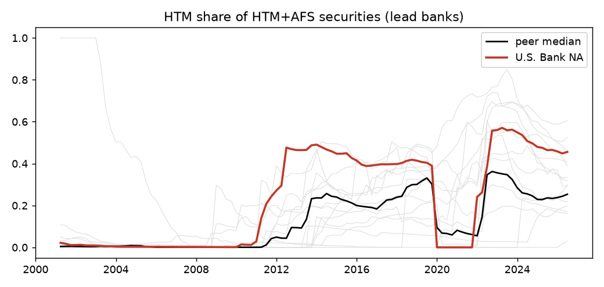

### 3.4 Capital, the rate shock and March 2023

**Conclusion** _(interp)_ [C, BC, O, P, Y, Z]: USB ran its capital closer to the minimum than its peers for most of the 2010s and paid out most of its earnings. That choice was affordable while rates were low. In 2022 the Union Bank purchase, a large and long-dated securities book and rising rates combined to leave it among the more exposed large regional banks, which the market priced in March 2023. It came through without regulatory capital stress, partly because rules then let banks of its category exclude securities losses from capital. Its capital ratio stayed below the peer median at most year-ends through 2025 and was above it at 2026Q3. It has not crossed into the stricter Category II.

- **Capital level and payout** _(calc)_ [C]. Holding-company CET1 (common equity tier 1 capital over risk-weighted assets) was the lowest of 11 at every year-end 2015-2020. The Y-9C now covers all ten peers through 2026Q3. On it, USB was above the ten-peer median only in 2021 (+0.23 points, rank 5 of 11) and below it in 2022-2025: -1.11 in 2022 (lowest of 11), -0.36 in 2023, -0.54 in 2024 and -0.08 in 2025 (rank 8 of 11), when its ratio was 10.8%. At 2026Q3 it was 10.83 against a median of 10.39, rank 4 of 11. The first version of this report put USB at the peer median in 2025; that rested on 10-K data that covered only some peers and is superseded. Total payout (dividends plus buybacks) was 68.2% of net income over 2002-2025. Low CET1 relative to peers is not evidence of thin capital relative to requirements; requirement-adjusted headroom against peers was not computed.
- **The Union Bank pause** _(fact; calc)_ [UB]. Buybacks of $10,556 million in 2018Q1-2021Q2 fell to $0.2 billion over the 13 quarters from the announcement quarter, resuming at $122 million in 2024Q4.
- **Exposure in 2022** _(calc)_ [C]. At 2022Q4 the unrealized loss on HTM securities was -32.5% of tangible equity, second worst of 11 after Truist (-33.5%); securities were 25.7% of assets, the highest of 11. An illustrative pro forma CET1 that also counted unrealized losses on both securities books would have been about 4.56% at 2022Q4 (assumes a 21% tax rate) _(est)_ [C]. The bank had opted out of counting AOCI in regulatory capital, so none of these losses reduced its reported ratios _(fact)_ [Z].
- **March 2023** _(calc; fact)_ [P, O, Z]. From the 2023-03-08 close to 2023-03-17 USB's stock fell -27.6% against a peer median of -19.0% [P] (-22.0% on Module O's ten-bank set [O]); three of nine peers fell more [P]. Deposits fell 3.1% across the combined bank in 2023Q1, eleventh worst of 29 banks over $100 billion, but the outflow was concentrated in the just-acquired Union Bank charter (-13.5%) rather than legacy U.S. Bank (-1.2%) [O]. The bank took a $1.0 billion one-day Bank Term Funding Program advance on 14 March 2023 and repaid it the next day; the 10-Q lists the program as a liquidity source but not the draw, and the purpose is unknown _(fact)_ [Z, O]. All three rating agencies cut the holding company by one notch in 2023 _(fact)_ [P].
- **March 2023 against the whole industry** _(calc; est)_ [P, O]. On CRSP total returns (via WRDS), USB's March 8-17 fall was in the worst 5% of 371 listed U.S. banks, whose median was -12.7% [O]. A cross-section of 270 banks on pre-crisis exposures predicts -24.3% for USB from its size and uninsured share, so its residual is -3.2 points, and 27% of banks have a more negative one _(est)_ [O]. With dividends it was back at its March 8 value on 2023-12-14; 5 of the 10 other banks recovered later, so it was mid-pack, not near the back as price-only dates suggested [O]. From March 8 to the end of 2023 it returned 0.4% against a peer median of -6.6% [P]. Bond investors judged it differently: USB's holding-company bond spread went from 52 basis points on March 8 to 167 on March 17, a multiple of 3.2 against 3.8 for the P-core median (TRACE via WRDS) [O, P]. _(interp)_ For a week the equity market treated USB as worse than the median peer while the bond market treated it as a better credit. That fits a fall driven by worries about franchise and capital rather than default.
- **Stress tests** _(fact; est)_ [H, Y]. In the Federal Reserve's tests, USB's projected capital drawdown went from much smaller than peers' (0.2 points against a core-peer median of 1.6 in the 2020 cycle) to larger (2.4 against 2.2 in 2024) [H]. Module Y traces this to projected pre-provision revenue: the bank's stress advantage came from revenue and has mostly gone, not from lower projected losses [Y]. Our own severe scenario (losses 1.25 times the Fed's, peer-median revenue) cuts CET1 by 2.65 pp, implying a stress buffer of 3.81% _(est)_ [Y].
- **The $700 billion line (H22)** _(calc; fact)_ [H, BC, O, UB]. Banks with $700 billion or more of average total consolidated assets move from Category III to the stricter Category II, under which unrealized securities losses would count against capital. The Fed released USB from its Union Bank commitment to meet Category II standards on 16 October 2023, when its assets were below the line; the earlier suggestion that it shrank to avoid the line was withdrawn on review [H, UB]. The Federal Reserve's Regulation YY defines the test as the mean over four quarters of the daily-average assets each holding company reports on the FR Y-9C _(fact)_ [BC]. On that measure USB had $691.4 billion at 2026Q2 and $695.5 billion at 2026Q3, $4.5 billion below the line, and it has not reached $700 billion in any quarter _(calc)_ [BC]. A four-quarter average of quarter-end assets did pass $700 billion in 2026Q2, driven by one quarter-end spike to $725.9 billion, but that is not the regulatory measure [BC]. A crossing at 2026Q4 would need a quarterly average of at least $706.2 billion, 0.59% above the 2026Q3 quarterly average _(calc)_ [BC]. **The size question is settled: USB was not a Category II firm on data through 2026Q3.** On H22 (growth managed around the threshold), USB's average assets grew 0.97% a year from 2023Q2 to 2026Q3 against a ten-peer median of 2.95%, after 5.72% a year in 2010-2019 _(calc)_ [BC]. That is consistent with H22 but does not show intent: industry-wide balance-sheet restraint, the Fed's 2023 relief and peers' acquisitions are other explanations, and no filing states a size target _(interp)_ [BC]. H22 is "consistent, not shown". Management reports a Category II pro forma CET1 including AOCI of 9.1% at 3Q26 against a 7.1% minimum _(fact)_ [BC].

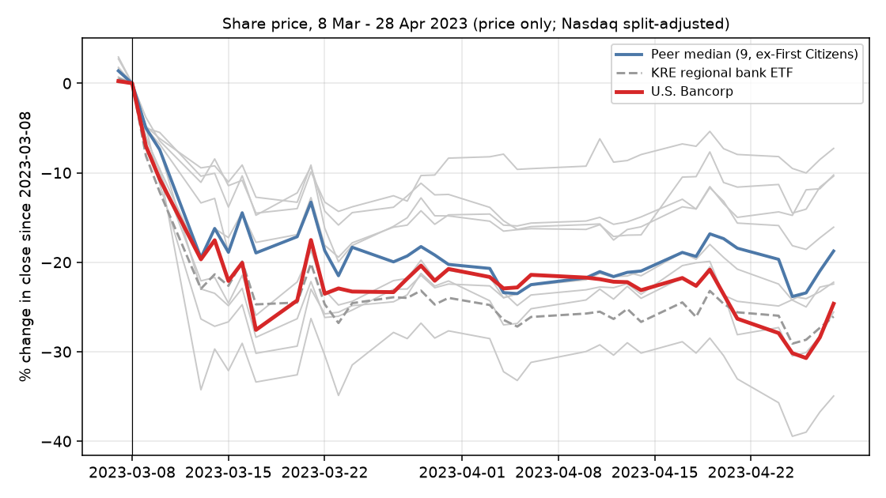

### 3.5 Workers

**Conclusion** _(interp)_ [F, F-local, I, S]: For most of the past quarter century USB ran with fewer workers and paid them a smaller share of what they produced than its peers did, and it adjusts headcount to revenue faster than any other large bank in the sample. That lean model has faded: by 2024 the bank employed more people per dollar of assets than core peers, at roughly median pay. Disclosed median pay rose faster than peers' after wage floors were introduced. Public data cannot show whether any of this reflects lower pay for the same work, because no public source links a worker's pay to an employer. Licensed profile data (Revelio Labs via WRDS), added on 2026-11-11, come closer: on modelled salaries for the same job USB pays like the regional banks and less than the largest banks, and its staff leave a little less often than peers'. Those salaries are model predictions, not payroll. **No original causal labor result survived review**, including a rebuild of the noncompete design on the new employer panel. Three descriptive results from public data are new and correctly qualified, and are flagged below; the profile-data results are a further descriptive layer.

This is the project's lead angle, so the limits come first _(interp)_ [F]. Every causal design here is estimated on panels of banks, counties or metros; U.S. Bank is then located within the distribution. Nothing in this section is a causal finding about U.S. Bancorp alone.

**The firm's labor model** _(calc; est)_ [F].

- **Labor share was the lowest or second-lowest of six in most years to 2015.** Compensation as a share of value added averaged 29.5% at USB against a core-peer median of 41.5% in 2001-2007; on the independent bank-level basis 27.1% against 40.5% _(calc)_. The review called this "the most robust result in the memo". After 2020 the order reversed by a few points (49.2% against 45.0% in 2020-2025), driven by falling profit per worker more than rising pay _(calc)_. The obvious alternative, business mix (payments and trust are less labor-intensive), is not excluded _(interp)_.
- **Headcount tracks revenue.** USB's employment growth responds to real revenue growth 0.37 more than peers' (peer elasticity 0.22), the highest of 15 large banks _(est)_. With one firm identifying the difference, the clustered standard error overstates precision; the reliable statement is the rank, 1 of 15 _(interp)_ (Module F review).
- **Pay per worker: first, then median.** Real pay per FTE (2025 dollars) was $95.7 thousand against a peer median of $71.4 thousand in 1990, first; by 2019 it was 137.6 against 137.9, fourth; real growth was 2.6% a year at USB against 1.3% at the peer median in 2010-2019, which closes a gap rather than paying a premium _(calc)_. Pay per FTE also reflects job mix, outsourcing and bonus accruals, which are not observed _(interp)_.
- **Union Bank** (also 3.7). Combined bank FTE fell 14,439 (18.1%) from the announcement quarter to 2026Q2; net of the Union Bank staff the seller kept and of the pre-close decline, at least 8,419 (11.4%) _(calc)_. A synthetic-control comparison with 24 non-merging banks puts the gap inside the range seen for placebo banks, and Union Bank's own three-year change is inside the range seen after 71 large mergers in 2002-2022 _(est)_. H17 (an unusually deep post-merger cut) is not supported. The front-line retention promise ("All MUFG Union Bank front-line branch employees will be retained") cannot be verified from public data in either direction _(fact)_. Profile data (below and 3.7) are consistent with front-line staff falling faster than at peers in California, but they do not settle it.
- **Rent sharing (H2).** Do profits reach workers? Using swings in profit driven by interest rates, the pass-through to average pay is not detectably different from zero: 0.020 on the bank panel (confidence interval -0.006 to 0.045) _(est)_. A placebo shows that 64% of a naive firm-level estimate is measurement artefact (0.025 against 0.039) _(est)_. **[New, descriptive.]** USB's own slope ranks near the middle of 50 banks, so H2 (pass-through weaker here than at peers) is undeterminable.
- **Pay geography (H18).** In visa wage filings (mostly technology workers), USB's pay differences across 14 hubs are 0.78 of local market differences (95% interval 0.71 to 0.84) _(est)_. **[New, descriptive.]** The bank sets pay largely to local markets, not on a national scale, for this group; H18 is not supported. The filings cover only sponsored workers.
- **Union Bank headcount bridge.** **[New, descriptive.]** The account above, separating what MUFG kept from post-close cuts, is a checkable reconstruction of a public commitment that the filings do not provide.
- **Broad-based pay and benefits** _(fact; calc)_ [F, I]. A $15 minimum wage was announced by January 2018 and a $15 to $20 range appears in the FY2022 10-K (an ESG report gives a conflicting $18). Disclosed median employee pay rose from $58,269 (FY2017) to $95,307 (FY2025), 24.5% in real terms against 9.9% for the peer median and 8.1% for the CEO; the CEO pay ratio fell from 205:1 to 178:1 _(calc)_ [F]. The median employee is re-identified only every three years and Union Bank changed the workforce, so the comparison is composition-sensitive _(interp)_. The 401(k) match has been 100% of the first 4% of pay since 2001 and employer contributions per participant ran at 0.63 of the peer median in 2013-2019; but USB is unusual in keeping its cash-balance pension open to new hires, so "lean" applies to the defined-contribution plan only (Module F review).
- **Interchange regulation (H24) and the 2017 tax cut.** Banks covered by the 2011 debit interchange cap show no detectable cut in employment or pay relative to exempt banks; the test has weak power (H24 not supported) _(est)_. After the 2017 tax cut, C-corporation banks (which got the larger rate cut) raised pay per FTE slightly relative to S-corporation banks (-0.016 on the S-corporation interaction, 95% interval -0.024 to -0.008), with stated confounds _(est)_ [F].
- **Automation (H6).** At industry level, occupations more exposed to large language models grew 2.5 percentage points a year slower per standard deviation of exposure in 2019 to 2025 (SE 1.3), a change from the earlier period; tellers fell from 518,270 jobs to 314,650 nationally (2012 to 2025) _(est)_ [F]. At the firm, profile data now give a crude test: the GPT-4 exposure of USB's external hires was 0.586 in 2019 and 0.584 in 2025, with no shift relative to peers, on coarse role groups _(est)_ [F]. H6 is weakly supported at industry level only; no shift is detected at the firm. The bank's technology and communications expense rose 86% over 2016-2025 against 46% for all noninterest expense, partly a presentation change _(calc)_ [S]; the 2025 annual report's AI claims are company statements not linked to headcount _(fact)_ [S].

**Employer-level profile data, added 2026-11-11** _(est; calc)_ [F, F-local]. Revelio Labs builds position records from public professional profiles, mostly LinkedIn; the project used cells of employer, month, place, role and seniority, through the University of Minnesota's WRDS subscription, and downloaded no individual profiles. The limits come first, and they apply to every figure below.

- *Coverage.* Professional jobs are better covered than branch and operations jobs.
- *Early years are thin* [F-local]. USB's Revelio headcount was 48% of its reported year-end count in 2005 and 93% in 2019.
- *Recent years overshoot.* People record exits late, so the count was 112% of the year-end figure in 2025 and recent separations are understated.
- *Salaries are modelled.* They are predictions from title, company, place, seniority and year, not payroll, and the company is one of the model's inputs.
- *Today's corporate tree.* Union Bank and nine other acquired subsidiaries are removed before they closed; Firstar and Mercantile cannot be separated.

What the data show, all descriptive:

- **Pay for the same job.** For the same metro, role, seniority and start year in 2015-2025, the P-core median's modelled starting salary is at par with USB's (-0.002 log points). Wells Fargo (0.101), JPMorgan (0.096), Citigroup (0.140), Bank of America (0.056) and Capital One (0.077) pay more; PNC (-0.067) and Huntington (-0.076) pay less _(est)_ [F]. The pooled P-core premium moved from -0.027 for 2015 starts to 0.019 for 2025 starts, so USB went from paying slightly more than regional peers for the same job to slightly less [F]. This repeats the visa-filing pattern above, now for all roles. It does not test rent sharing, and H2 stays undeterminable.
- **Turnover.** USB's external separation rate was 13.1% in 2021 against a P-core median of 16.4%, and the share of new positions filled from inside was 33.3% against 42.4% _(calc)_ [F]. The company's own ESG report gives voluntary attrition of 16.47% for 2021, above Revelio's all-cause figure, which shows that profile data undercount exits [F].
- **Staff outside the United States.** In December 2025, 6,391 of USB's profiled staff (8.3% of those with a country) were abroad, mostly in Poland, Ireland and the United Kingdom; India rose from 111 in 2015 to 510 _(calc)_ [F]. Contractors and outsourced work are still not measured.
- **Causal designs.** Only the Minnesota noncompete design could be rebuilt, as a comparison of the same banks' Minnesota and other-state staff before and after the 2023 ban. Separations changed by -0.038 points a month (randomization p 0.75); the test could detect only a change of about 26% of the usual separation rate, and the hire-rate version fails a placebo date _(est)_ [F-local]. Rent sharing cannot be rebuilt on modelled salaries, and the merger designs would rest on 15 employers. No causal labor result holds after the update [F].

**The Twin Cities banking labor market** [F-local] (Chapter 4 has the employer view).

- [F-local] Metro commercial-bank employment was 15,454 in 1990, peaked at 37,262 in 2019 and was 26,451 in 2025 _(calc)_; a 2016 reclassification in Hennepin County means levels after 2015 are not comparable with earlier ones.
- [F-local] Bank pay relative to the local all-industry average rose from 1.08 to 1.71 times, above comparison metros since about 2012; tellers, however, were paid about 0.05 below the comparison-metro median relative to the local average in every window _(calc)_.
- [F-local] The branch-employer market is unconcentrated (a branch-count index of 462 in 2022, 10th percentile of large metros), and a national study of 20 mergers finds no effect of merger-induced concentration on teller wages, with an interval that does not exclude a 1% fall _(est)_. By employment rather than branches the picture differs: on profile data USB and Wells Fargo had 31.4% and 41.9% of the metro's commercial-bank jobs in 2019 _(est)_. H4 (local concentration holds wages down) is still not supported, because the national design finds no wage effect of concentration and the rule needs both.
- [F-local] Minnesota's 2023 noncompete ban: the test cannot detect plausible effects (minimum detectable effect about 13 log points), and the rebuild on employer profile data is also underpowered, so H5 is undeterminable _(est)_; the role of non-solicitation clauses (H27) is also undeterminable.
- [F-local] Quarterly hire rates in local depository credit fell from 13.0% (1998) to 3.7% (2024) _(calc)_.

**Original result?** _(interp)_ The vision asked for at least one result the labor-economist reader would accept as original and correctly qualified. The honest answer is that none of the pre-specified causal designs produced one: the top-ranked design (bank jobs after merger-induced branch closures) had no usable first stage (instrument F statistic of 0.4) [F-local], and the interchange, concentration and noncompete designs replicate or extend published nulls with stated minimum detectable effects. The three new descriptive results above are the contribution. The labor-share fact is the best supported. The employer-level profile data added on 2026-11-11 did not change this answer: the one design they could rebuild is still underpowered [F-local].

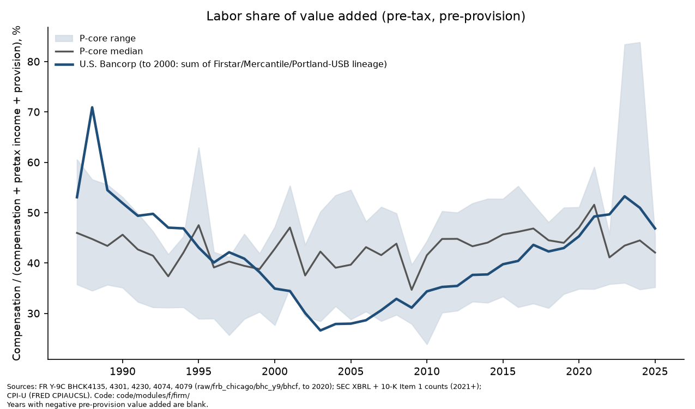

### 3.6 Conduct, controls and incentives

**Conclusion** _(interp)_ [H, I, R, L]: The conduct record since 2011 falls into separate families with different causes, not one cultural root. The largest, anti-money-laundering, is the one case where the documents tie failure to cost decisions: the bank stipulated that it capped compliance alerts to fit its staffing. The consumer sales-practices case is the one case with an incentive finding, at the front-line level, which proxy statements do not show. No named-executive pay metric rewarded account growth or cross-selling; whether profit-based business-line pay rewarded lower compliance spending cannot be tested from proxies. Pay consequences were applied in 2013-2017, largest in 2017, and none tied to a regulatory matter appears after 2018.

**The record** _(fact)_ [H]. Three families plus a record-keeping matter: mortgage servicing (2011 orders, found in "continuing noncompliance" by the OCC in 2015), anti-money-laundering (2015 OCC order; 2018 deferred prosecution agreement and related actions), and consumer sales and service (2022 and 2023 consumer-bureau and OCC orders), plus 2024 SEC and CFTC orders on off-channel communications, part of an industry sweep. No court has adjudicated any of these on the merits: each is a consent order, settlement or deferred prosecution agreement.

**The anti-money-laundering case and the cost culture (Q2)** _(fact)_ [H]. The deferred prosecution agreement's statement of facts, which the bank stipulated, says: "USB capped the number of alerts generated by its transaction monitoring systems based on staffing levels and resources and failed to monitor non-customer Western Union transactions at branches of the Bank". It recites that compliance requested but did not receive adequate funding for computers and other hardware, and that a below-threshold testing program was stopped in April 2012 for resource limitations. It recites complaints that investigators were paid below-market salaries; it does not find that they were (Module H review). The then Chief Compliance Officer concealed the caps from the OCC. The cash cost of the 2018 package was $613M _(calc)_. Afterward the bank reported spending over $200 million on enhancements and increasing AML staff 156% (self-reported; baseline not stated). **This supports the cost-culture explanation for this family only** _(interp)_. No other order contains a staffing finding.

**Incentives (Q3, H15)** _(fact; calc)_ [H, I]. The 2022 sales-practices order found that the bank "imposed sales goals on bank employees as a factor in evaluating employee performance" and paid incentives for product sales, over 2010-2020, affecting "a small percentage" of new accounts; penalty $37.5M; the bank neither admitted nor denied [H]. No incentive metric in the named-executive plans in any of 25 proxies (2002 to 2026) rewarded account growth, cross-selling or fee growth; plans paid on earnings per share, business-line pretax income and return on equity [I]. Front-line scorecards are not public. H15 is **weakened** _(interp)_ [I].

**Did pay respond to misconduct?** _(fact; calc)_ [I, R]. In 2017 the compensation committee charged a $608 million legal and regulatory accrual to executives alone, cutting their earnings-per-share funding to 56.6% against 97.7% for other employees [I]. Earlier, in 2013-2015, smaller individual bonus cuts were made for compliance. The link from the 2017 charge to the 2018 matters is an inference, since the proxy names no matter, and the Chief Risk Officer's bonus was raised in 2017 and 2018 for anti-money-laundering improvements. No pay reduction tied to a regulatory or legal matter appears for 2018-2025, and no proxy reports that a clawback was ever exercised [I]. The Chief Risk Officer at the time of the 2018 orders retired 249 days later with his performance units still vesting; no filing ties any executive departure to an order [R].

**Incentive targets and adjustments (Q11)** _(calc)_ [I]. The corporate EPS target was missed in 9 of 15 plan years 2011-2025, yet overall bonus funding in the miss years 2013-2017 ranged from 81.8% to 101.0%, because the larger share of funding rides on business-line targets that are not disclosed. Adjustments to plan EPS raised funding in 6 years and lowered it in 7, but the net effect over 2019-2024 was +110 points. This is descriptive; it does not show targets were managed.

**Do complaints lead enforcement (Q12)?** _(calc)_ [H, L]. CFPB complaints per $bn of assets were above the peer median in all thirteen years, driven by cards, prepaid, credit reporting and mortgage; for deposit accounts alone the rate is at or below the median. The 2020 surge in complaints about state unemployment-benefit cards coincided with the account freezes later cited in the 2023 orders; it was contemporaneous, and partly an industry event, not an early warning. 38.0% of 2020-2025 complaints closed with relief, second highest of 15; the relief code is the company's own and its use changed over time, so this is not a quality ranking.

**Board and power** _(calc; fact)_ [R, U]. Two of 11 non-executive directors have a main employer in the Twin Cities (18.2%), against 7.9% at eight peer banks; the difference is not statistically distinguishable (p = 0.27) [R]. Federal lobbying in 2025 was $1,550,000, at about 0.73 times the median of all peers per dollar of assets since 2019 (0.48 times the core and next-tier median), after a peak in 2017 of $3,410,000 [U]. Trade associations may carry more: the 2024 political-activities report lists $2,037,000 as the political share of dues to the Electronic Payments Coalition, 1.31 times the bank's own reported federal lobbying that year; whether that is additional spending is not established [U]. PAC giving is at the peer median, bipartisan, and follows committee jurisdiction more than party _(calc)_ [U].

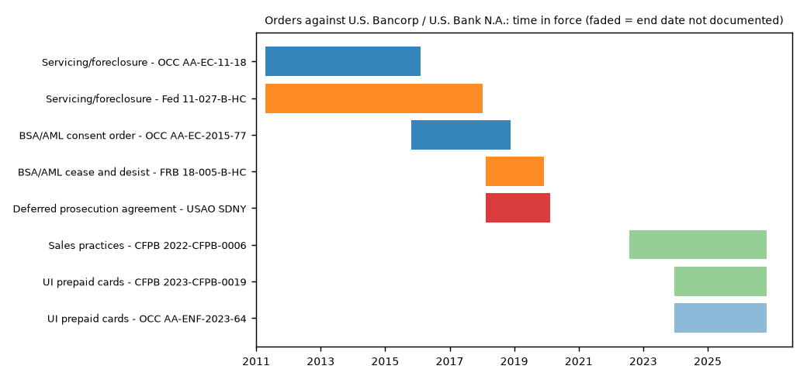

### 3.7 Union Bank: one deal, every constituency

**Conclusion** _(interp)_ [UB, E, B, F, V, H, M]: The 2021-22 acquisition of MUFG Union Bank was bought cheaply and integrated quickly. Cost savings were reported as met, which the outside data neither confirm nor contradict, and the headcount reduction was normal for a deal of its size. But it cost shareholders much more tangible-book dilution than promised, paused capital return for 13 quarters, moved the loan book toward California, and arrived just as rates rose. Whether it created value for shareholders is undeterminable without Union Bank's own earnings, which are not disclosed. The community pledge is large on paper and unverifiable in practice.

| Constituency | Promise | Outcome | Label |
|---|---|---|---|
| Shareholders | Price: about $8.0 billion announced; 1.3x tangible book | Booked $7,514 million; $10,458 million including the discounted liability to MUFG for excess capital [UB] | _(fact)_ |
| Shareholders | Tangible-book dilution about 1%, earn-back about 1.5 years | About 11% dilution, earn-back about 2.0 years (company figures, January 2023) [UB, E] | _(fact)_ |
| Shareholders | $900 million cost savings | Reported met, a year early [Q, E]; combined expense fell -8.9% (2021-2025) against a peer median rise of 7.9%, an upper bound on deal savings [E] | _(fact; calc)_ |
| Shareholders | Merger charges about $1.2 billion | $1,493 million, 24.4% over [B] | _(calc)_ |
| Shareholders | Value created (H14) | Undeterminable, leaning toward not value-destroying: realized return on $8,642 million of capital estimated at 9.0% to 17.5% against a 10% cost of equity [E] | _(est)_ |
| Regulators | Category II commitments; three California branch divestitures (about $480 million of deposits) | Commitments released 16 October 2023 without breach shown; divestitures made [H, M] | _(fact)_ |
| Workers | Front-line branch staff retained | Not verifiable; combined FTE fell at least 8,419 (11.4%) net, inside the typical range (H17 not supported) [F]. Profile data: a front-line proxy in California changed by -13.0% against -6.9% at the four largest banks there (2021-2024), consistent with faster front-line cuts but not proof [F] | _(calc; est)_ |
| Communities | $100 billion community benefits plan over five years, about $60 billion in California | A private pledge; the OCC "does not monitor compliance with nor enforce" such agreements; the bank says it surpassed the goal in 2025 on its own counting; no independent progress report found [V, Q] | _(fact)_ |

Further facts matter for later chapters. The deal moved exposure west: California's share of the commercial real estate book rose from 24.6% (2020) to 40.1% (2022) _(calc)_ [O]. And Union Bank branches in California, Oregon and Washington were exited at 22.6% over June 2022 to 2025, against 12.3% at Wells Fargo and 9.2% at JPMorgan in the same states, though USB's legacy branches there exited at a similar 21.4% _(calc)_ [F]. Profile data (Revelio via WRDS) add a third: the post-merger fall in headcount was concentrated in California, where the group's headcount changed by -15.3% from September 2021 to December 2025 against -6.2% at Wells Fargo, JPMorgan, Bank of America and Citigroup combined, while outside California it rose 3.8% _(calc)_ [F]. Of 3,234 Union Bank position ends from December 2022 to December 2025, 41% were moves inside the group _(calc)_ [F]. In the Twin Cities USB's profiled headcount barely moved (11,848 in December 2022, 11,729 in December 2025) [F-local].

The full promise-by-promise record, including investor-day targets, is in `report/usb_promises_scorecard.md`.

### 3.8 Customers

**Conclusion** _(interp)_ [L, H, G]: On prices and fees USB behaves like the large-bank pack: it followed the first movers in cutting overdraft fees, passes rate rises through to savers at about the median, and draws complaints at about the median for deposit accounts. Its documented consumer harms, in card add-on billing (2014), sales practices (2022) and benefit-card freezes (2023), are each tied to a specific program, not to everyday pricing.

- **Overdraft** _(calc; fact)_ [L]. Overdraft-related service charges fell from $476 million (2019) to $219 million (2023), -54%, against a median bank-level fall of -50% at 14 peers; adding Union Bank to the 2019 base gives -63%, inside the peer range. USB announced its changes on 2022-01-19, after PNC, Chase, Capital One and Bank of America. "Faster than peers" is not established.
- **Savings rates** _(calc)_ [L]. Cumulative savings and money-market beta to 2023Q4 was 0.35, sixth lowest of 15 (median of others 0.40): inconclusive-to-against the idea that USB is among the least responsive payers. A posted fallback savings tier paid 0.25% in April 2024 when 3-month Treasury bills yielded 5.44% _(fact)_ [L]; that is one product's floor, not the average rate.
- **Complaints (H25)** _(calc)_ [L, H]. Checking and savings complaints per $ billion of deposits were 3.58 against a peer median of 4.11 (2025); cards 46.0 against 43.3. H25 (complaint rate below the peer median) is mixed by product and undeterminable as stated.
- **Mortgage access in the home market** _(calc)_ [G]. In 2023-2025, 13.0% of USB's metro mortgage originations went to low- and moderate-income tracts against 19.2% at other lenders; about a third of the gap is product mix (home-equity lines). Conditional denial gaps for Black applicants were larger at USB than at the average lender (+8.2 points against 5.3), not clearly larger than at peers; this is a screen without credit scores, not evidence of discrimination.

### 3.9 Narrative, promises and technology

**Conclusion** _(interp)_ [Q, W, S, E]: Management's long-term financial targets were met less often than they were reset, and the retreat in public language since 2024 is real but partial. Promises to investors are checkable and often missed; promises to communities are mostly scored by the bank itself.

- **Targets** _(calc)_ [Q]. The 2013 long-term targets were missed on five of six measures; the 2016 set was met on four of six (three if a 2018 restatement is applied); the return-on-assets goal range was lowered in 2016 after the bank had fallen below it, and the ratio was inside the lowered range in only 1 of 6 years in 2020-2025. The efficiency target of "low 50s" became "mid-to-high 50s" in April 2025.
- **Guidance** _(calc)_ [Q]. Of 93 scored guidance items 2022-2026, 49 landed inside the range, 23 beat and 21 missed: not systematically conservative.
- **Promises by constituency (H23)** _(calc)_ [Q]. The project's scorecard scores 38% of scorable investor promises as met against 91% of the much smaller number of scorable community promises [Q], but community "met" verdicts rest mostly on the bank's own later reports and many are not yet due. H23 is undeterminable on comparable evidence (`report/usb_promises_scorecard.md`).
- **Language** _(calc)_ [Q, W]. The word _reputation_ fell from 40 to 5 mentions in the FY2025 10-K while _brand_ rose from 4 to 33, the largest such shift among 14 peers; reputation remains a named risk category. Climate language in proxies and risk factors fell after 2023. The bank has not withdrawn its 2050 net-zero or $50 billion environmental-finance goals, but its promised 2030 interim financed-emission targets were never published [W].
- **Technology** _(calc)_ [S]. Technology and communications expense rose from $1,188 million to $2,211 million over 2016-2025; per employee it nearly doubled. The line was re-defined twice, and its growth cannot be attributed to any outcome. Regulators found systems-related control failures in 2015, 2018, at Union Bank in 2021, and in the 2023 benefit-card orders.

### 3.10 How the parts explain one another

This section states the report's central interpretation, all of it _(interp)_, built only from findings above.

1. **The fee model probably shaped the funding.** Corporate trust, wealth and payments generate large institutional balances, which are cheap when rates are near zero and rate-sensitive, uninsured and seasonal when rates rise. If the bank's institutional and booked balances come mainly from those businesses, as every memo reads them but no source confirms (H16 is undeterminable), that one feature is consistent with its high uninsured share, its above-median deposit beta, its seasonal deposit swings and the concentration of its Twin Cities deposits in two offices (3.2, 4.2). The split of free deposits by segment is an accounting identity, not a cause, and across banks the uninsured share did not significantly predict 2023 outflows [O].
2. **The funding shaped the balance sheet and the capital choices.** With deposits that grew fast in 2020-2021 and a thin capital ratio by peer standards (3.4), the bank invested heavily in long-dated securities and then moved them into held-to-maturity as rates rose. Accounting rules for its category kept the losses out of regulatory capital. The 2022-2023 exposure was a balance-sheet decision of a kind many peers also made, not an accounting trick, but USB made more of it than most.
3. **Cost discipline and the worst conduct failure.** The lean-staffing model that delivered the best efficiency ratio in the industry (3.1) coincided with the lowest labor share in the group (3.5), which business mix may also explain. In anti-money-laundering, the bank stipulated that alerts were capped based on staffing levels and resources (3.6). That is consistent with a cost culture reaching a control function, in the one case where the documents record the decision; Module H does not claim the pattern generalizes, and no other order contains a staffing finding.
4. **The edge eroded from both ends.** As the cost model converged with peers (more people per dollar of assets, more spending on technology and compliance) and the funding advantage disappeared with rising rates, the fee franchise alone could not keep returns above peers (3.1). The Union Bank deal is a response to, not the cause of, that erosion: it bought deposits and scale at a low price but added cost, California exposure and dilution (3.7).
5. **Incentives tracked earnings, not conduct.** Executive pay plans rewarded EPS and returns; funding stayed near target through undisclosed business-line components even as EPS targets were missed; the visible penalties for misconduct were concentrated in 2013-2017 (3.6). No named-executive metric rewarded the sales behavior regulators later found; profit-based business-line pay may have rewarded lower compliance spending, which cannot be tested; and no pay reduction after 2018 is tied to a regulatory matter.
6. **The home market sits outside most of this.** Because most of the bank's Twin Cities deposits sit in two head-office booking offices, very likely national business balances, the bank's Twin Cities deposit numbers are probably dominated by national activity (Chapter 4). Its actual retail and lending presence in the metro is a solid second-tier franchise whose weight has been stable in deposits and falling in lending.

---

## 4. U.S. Bank and the Twin Cities

**Conclusion** _(interp)_ [G, M, Z, T, F-local, V, U, R]: U.S. Bank is the Twin Cities' largest bank by every headline measure, but most of its headline weight is probably national activity booked or headquartered here. As a retail deposit-taker it is a stable second-tier franchise with about a seventh of local deposits, much as in 1994. As a local lender its share has fallen sharply, in small-business loans as well as mortgages. As an employer it is large: on profile data it had about three in ten of the metro's commercial-bank jobs in 2019, and the Twin Cities did not lose share of its jobs on total headcount. As a civic actor it is visible (the head office, the board, the stadium name) but its board's local ties have thinned and its philanthropy is unexceptional relative to profit. The region's dependence on it is real but smaller and less measurable than the deposit headline implies.

Throughout this chapter "the metro" is the 16-county Minneapolis-St. Paul-Bloomington area, the same in every module.

### 4.1 Headquarters: what is here, and what is not

- **Head office and space** _(fact; calc)_ [T]. The holding company renewed its lease at 800 Nicollet Mall in October 2023 and owns U.S. Bank Plaza; it did not renew the Richfield campus lease, saying less office space was needed. Press reports put about 4,000 employees at the headquarters and 1,400 at Richfield; the Richfield staff moved mostly to Hopkins. Twin Cities banking offices fell 21.2% (99 to 78) between 2019 and 2025, but 16 of the 21 offices lost were in-store branches.
- **Minnesota was protected relative to the network** _(calc)_ [T]. Minnesota offices fell 22.3% (139 to 108) against 28.9% nationally; excluding offices that came from Union Bank, Minnesota was the least-cut of 22 states with at least 20 offices. On full-service branches Minnesota fell 11.2% against 27.7% elsewhere.
- **What is not here** _(fact)_ [A, Z]. The bank's charter and main office are in Cincinnati. Its Federal Home Loan Bank membership is Cincinnati, where it is among the five largest borrowers, and the lead bank's Federal Reserve district code is Cleveland, although the holding company is supervised from Minneapolis. The FY2023 10-K refers to liquidity from the FHLB of Des Moines; the conflict is unreconciled [Z].
- **Why it stayed (H11)** _(fact; interp)_ [K, Z]. The 1997 and 2001 merger filings record that Minneapolis kept the headquarters but give no reason. A contemporary Minneapolis Fed article notes that the merged institution's loans and deposits came to be reported as Minnesota-based. Among 24 comparison cities, Minneapolis went from 2 top-50 holding-company headquarters in 1994 to 1 in 2025, and that one has a Cincinnati-chartered bank. H11 (the city stayed a headquarters city for structural reasons) is undeterminable from the documents held.

### 4.2 Deposit-taker: the booking effect

**The headline is two offices** _(calc)_ [G, M, A]. The FDIC's Summary of Deposits assigns each bank's deposits to the office where they are booked. USB holds 41.1% of metro deposits in 2025 (rank 1), but 85.1% of its metro deposits ($81,600 million of $95.9 billion) sit in two downtown offices, the St. Paul Center and Main branches [G]. Excluding every office that holds at least 1% of metro deposits, USB's share is 14.6% (rank 2), against 14.9% in 1994 [G]. Module M, with a fixed $1.0 billion cut-off, gets 15.0% and puts Wells Fargo first at 23.6% [M]. The metro offices together hold 18.3% of the national bank's domestic deposits [G].

**What the booked balances are** _(interp)_ [G, M, C, V]. No public source says. Every memo reads them as consistent with corporate trust, institutional and payments balances booked at the head office, and the bank's own CRA examiners removed $36.6 billion of centralized deposits from the $83.3 billion in the Minneapolis assessment area in the 2016-2020 evaluation [V]. This is the single most consequential unresolved fact about the bank's home market, because it decides whether "Twin Cities deposits" are a local franchise or a national ledger entry. It is open question HM-1 in `report/usb_open_questions.md`.

**Retail share is stable; concentration is low** _(calc)_ [G, M]. The retail-like share of about 15% holds under other exclusion rules (16.6% in 1994 and 16.5% in 2025 for offices under $500 million) [G]. Once booking is removed, the metro deposit market is unconcentrated by large-metro standards (rank 26 of 40 metros) [M]. Entry is visible: JPMorgan Chase went from 0 metro offices in 2015 to 45 in 2026 [M].

**Branches** _(calc)_ [G]. USB's metro offices peaked at 103 (2016) and were 77 in 2026. Its closure rate over 2016-2025 (28.2% of offices open in 2016) is mid-pack against regional banks, though above Wells Fargo's 18.0%. A test for whether closures fall disproportionately on lower-income tracts finds a 0.9 percentage-point addition to a 5.0% baseline probability with a standard error of 1.0: no detectable disparity, at a sample size that cannot rule out moderate effects. H8 is weakened as stated. Its small-business half splits: the share comparison is supported (4.3), but whether small-business lending fell after closures cannot be tested, because the CRA files give county totals, not tracts [G].

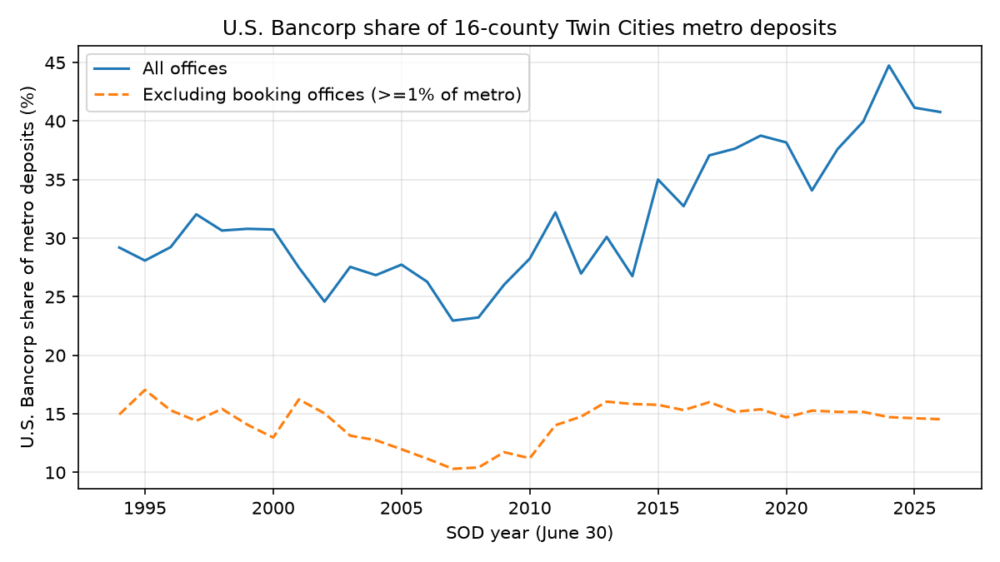

### 4.3 Lender

**Mortgage share has collapsed** _(calc)_ [G, M]. USB's share of metro mortgage originations by count fell from 11.7% (2011) to 3.9% (2025), but 2011 was a peak and the series changes definition in 2018 when open-end lines enter; on a constant first-lien definition the fall is from 12.1% to 2.2% [G]. By dollars it fell from 11.1% in 2010 (rank 2) to 3.0% in 2025 (rank 5) [M]. The market as a whole moved to nonbank lenders, whose share rose from 21.6% (2007) to 49.1% (2025) [M], so this is partly an industry shift.

**Small business** _(calc)_ [M, Z, G]. The CRA small-business files for 1996 to 2025 are now on disk, aggregated to holding companies. USB's share of metro small-business loan dollars fell from 35.8% in 1996 (as First Bank System) to 17.3% in 2010 and 8.6% in 2025 [M, G]. It ranked first or second in every year, and second behind American Express since 2023 [M]. The market fragmented over the same years (HHI 2,456 in 1996, 495 in 2025) [M]. USB's deposit share outside booking offices went from 15.3% to 11.2% and 14.6%, so its loan share per point of deposit share fell from 2.34 to 0.59 [G]. Hypothesis G-c (its small-business loan share fell faster than its deposit share) is supported [G].

Per local (non-booked) deposit dollar, USB's small-business lending fell from 17.2% in 1996 to 7.8% in 2000, 1.7% in 2023 and 1.8% in 2025 [Z]. Relative to the deposit-weighted group it went from 1.61 times (1996) to between 0.91 and 1.41 times in 1998-2014 and 0.72 to 0.86 times since 2017, so the relative decline dates from after about 2014, not from the 1990s mergers [Z]. Its loans are small: in 2025, 97.4% by count were under $100,000, and 81.2% went to firms with revenue of $1 million or less, against 44.2% at other lenders [G]. _(interp)_ That fits business-card lending inside the bank charter, which CRA data cannot separate, so part of the fall in dollar share is a shift toward many small credits [G, Z].

**Deposits against lending (Q24)** _(calc; interp)_ [M, G]. On deposits USB is a 15% bank in the metro; in mortgage dollars a 3% bank; in small-business dollars it had 8.6% in 2025, down from 35.8% in 1996. The local deposit position does not carry over into local lending share. Whether this reflects pricing, product mix or a decision to lend elsewhere cannot be separated.

**Examiners' view (favorable)** _(fact)_ [G, V]. The OCC rated the Minneapolis assessment area Outstanding in all five CRA evaluations read (2005-2022) and called its geographic distribution of home mortgage lending excellent for 2017-2020. The bank's overall rating was lowered from Outstanding to Satisfactory once, in the evaluation dated 2012-03-31, because of settled consumer actions elsewhere in the bank.

### 4.4 Employer

**The local share of the bank's jobs, now measured from profile data** _(est)_ [F-local]. No public source assigns jobs to employers, and from public data alone the bank's share of metro commercial-bank employment could only be bracketed at 5.5% to 74.7% in 2025 (central 20.1%). Revelio Labs profile data, licensed through WRDS, now give a direct if imperfect count, with the limits listed in 3.5. USB had 11,682 profiled employees in the metro in December 2019, 31.4% of QCEW commercial-bank jobs; Wells Fargo had 15,619, or 41.9%. The 2025 share (44.3%) is inflated by late-recorded exits and by the fall in QCEW jobs, so 2019 is the better year. The shares are approximations: Revelio's groups include non-bank subsidiaries, and QCEW may code some head-office establishments outside commercial banking.

**H3 is not supported on total headcount** _(est)_ [F-local]. H3 says the Twin Cities share of the firm's employment has fallen, with each acquisition accelerating it. On profile data the share was 16.9% in 2010 and 19.6% in 2020, rising by 0.26 points a year between deals (SE 0.03). Union Bank lowered it by 1.76 points in December 2022, a mechanical step: almost none of its 6,375 U.S. profiles were in the metro. The other acquisitions moved it by at most 0.28 points. The share was 16.6% in 2025. Holding USB's 2019 mix of roles and seniority fixed, the share fell by 0.09 points a year (SE 0.03), from 20.0% in 2010 to 18.3% in 2021. Within each kind of job a smaller share sits in the Twin Cities, while the firm's mix moved toward head-office roles; uneven profile coverage across roles could produce part of this pattern. In December 2025, 20.4% of USB's U.S. executives and 14.9% of its entry and junior staff were in the metro. The branch-staff share of the firm fell from 2.1% (2002) to 1.4% (2025), but branch staff are a shrinking slice of any bank. Confidence: medium, because the data are profile-based.

**Pay against the other big local employer** _(est)_ [F-local]. For the same role, seniority and start year in the metro, Wells Fargo's modelled starting salaries are 0.120 log points above USB's (SE 0.030). The mean modelled starting salary of 2025 metro starts was $105,080 at USB and $121,479 at Wells Fargo. USB's own metro starting salaries are 0.027 log points above its other U.S. locations for the same job. These are model outputs, not payroll.

**Signals of where work is going (Q19)** _(calc; fact)_ [S, T]. Visa-sponsored technology positions in Minnesota fell from 26% of the bank's filings (2015-2018) to 16% in 2025, while Irving, Texas (597 positions) now exceeds Richfield (517) _(calc)_ [S]. The leased operations-center list in the 10-K lost St. Paul, Cincinnati, Denver, Milwaukee and Portland after 2022 [T]. Profile data now count staff abroad: 6,391 in December 2025, with India rising from 111 in 2015 to 510 _(calc)_ [F]. A separate discovery-pass lead, that proxy statements disclose offshore headcount, has not been through review (plan/discoveries.md P2-04).

**What a headquarters loss would do (H10)** _(est)_ [Z]. Across headquarters losses in 60 metros, losing-metro bank employment shows no detectable change relative to comparison metros (+0.9 log points at five years, standard error 3.7). The sign changes with the sample: events whose window ends before the 2016 reclassification give -3.4% at ten years. Applied to the Twin Cities, the 95% interval for the ten-year effect is -6.8% to +9.5% of 2025 metro bank jobs (-1,801 to +2,506 jobs). Confidence is low. USB is larger relative to its metro than any event in the sample, so this is an extrapolation. H10 is not detected for bank employment and untested for philanthropy, professional services and civic leadership. One partial check: the auditor signs in Minneapolis, as Norwest's auditor stopped doing after its headquarters left in 1998 _(fact)_ [Z].

### 4.5 Civic actor

- **Board and network** _(calc)_ [R]. Around 2016-17 USB's board shared directors or affiliations with 5 of the other 12 Twin Cities public companies, the most of any; in 2026, with 2. The network map (`report/usb_network_map.md`) draws these ties; it shows association, not influence.
- **Philanthropy** _(calc; fact)_ [V]. The U.S. Bancorp Foundation's grants were 0.56% of net income on average in 2019-2023 against a peer-foundation median of 0.87%, rank 9 of 12; banks split giving between foundations and corporate budgets, so this understates total giving. Grants jumped to $66.4 million in 2024. Where the money goes cannot be determined: 93.2% of grant dollars sit in unitemized attachments. The only Minnesota figure is a third-party ranking for 2012 that put 7.5% of USB's grants in Minnesota, against 16-17 percent for several other Twin Cities corporations; that comparison is not like-for-like.
- **Political presence** _(calc; fact)_ [U]. State lobbying was $85,000 in 2025, a small fraction of federal. Minnesota's congressional delegation received 8.0 percent of the PAC's itemized dollars against 1.9 percent of seats. The bank holds a Minneapolis city banking-services contract approved in 2025. The 2015 stadium naming deal was reported at $220 million over 20 years; under the use agreement all naming revenue goes to the team, none to the public stadium authority.
- **Taxes** _(fact; calc)_ [X]. Minnesota's state income tax cannot be isolated from the 10-K; it is at most $15 million for 2024. California is the largest state cash payer ($120 million of $170 million in 2025). Property tax on identified bank-paid Minnesota premises is about $4.2 million, a floor.
- **Tax-credit and climate investing** [X, W, V]. Project locations are not disclosed anywhere on file, so the Minnesota share of the bank's affordable-housing and renewable-energy tax-credit investment is unknown (the second half of H20 untestable).

### 4.6 How exposed is the region to this one institution? (Q28)

| Dimension | Measure | Value | Label | Reading |
|---|---|---|---|---|
| Deposits, booked | Share of metro deposits [G] | 41.1% | _(calc)_ | Mostly national balances |
| Deposits, retail-like | Share excluding offices of 1%+ of metro deposits [G] | 14.6% | _(calc)_ | Second of many; stable since 1994 |
| Locally headquartered share | Metro deposits held by metro-headquartered institutions, ex-booking [Z] | 40.3% | _(calc)_ | Down from 91.6% in 1994 |
| Without USB | Same share if USB left, ex-booking [Z] | 25.7% | _(est)_ | Arithmetic scenario, not a forecast |
| Mortgage lending | Metro originations by count, all products [G] | 3.9% | _(calc)_ | Minor (2.2% on a constant first-lien definition) |
| Small-business lending | Metro dollars, 2025 [M] | 8.6% | _(calc)_ | Second; down from 35.8% in 1996 |
| Bank employment | Share of metro commercial-bank jobs, profile data, 2019 [F-local] | 31.4% | _(est)_ | Large; second to Wells Fargo |
| Headquarters loss | Ten-year effect on metro bank jobs [Z] | -6.8% to +9.5% | _(est)_ | No detectable effect; wide |
| Philanthropy | Minnesota share of grants (2012, third party) [V] | 7.5% | _(fact)_ | Single year; not like-for-like |
| Public finance | Principal banker to state or city | Not established | | Shared with Wells Fargo in records found [U] |

_(interp)_ The region would notice USB's departure most in the things a deposit table cannot measure: senior jobs, the corporate audit and legal work that follows a head office, board service, and civic sponsorship. Those are exactly the dimensions on which the public record is thinnest. On the measurable dimensions, the local banking system is competitive, increasingly served by credit unions (from 12.0% to 20.3% of ex-booking bank-plus-credit-union deposits) and nonbank lenders, and not dependent on USB for retail credit [Z, M].

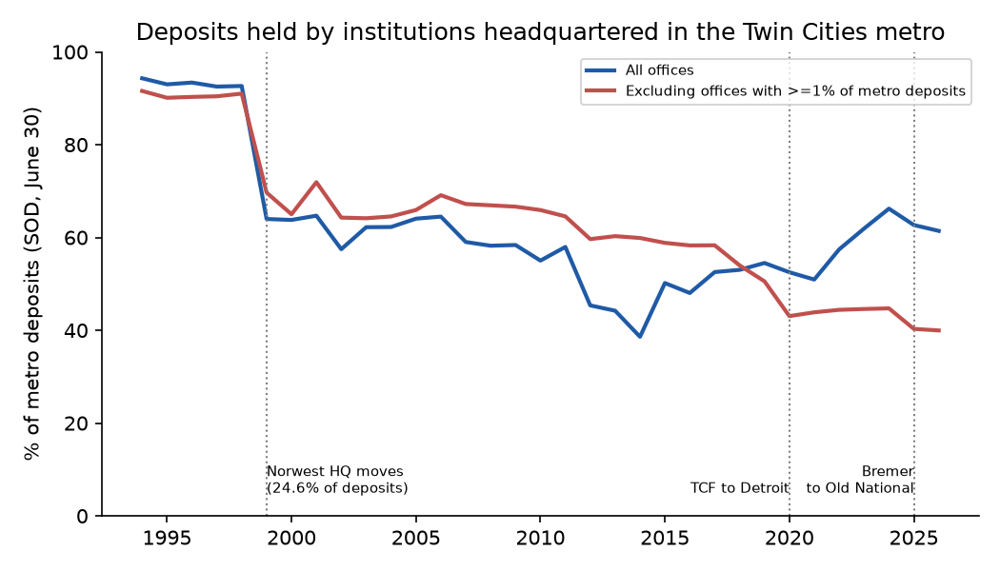

---

## 5. Valuation and strategic outlook

**Conclusion** _(interp)_ [E, P, Y, J, BC]: The market prices USB as an ordinary large regional bank. It trades in line with peers on earnings and at a small premium on tangible book value, most of which is an artefact of unrealized securities losses depressing book value. The share price assumes the bank can sustain returns of about 14% on tangible equity excluding those losses; our normalized estimate is a little above that. Analysts' forecasts tell a similar story: on them the price implies a cost of equity of 9.0%, below the regional median. Shareholders have earned much less than at peers since late 2016, after earning more over the longer run. The central strategic problem is earnings power (margin and funding), not credit or capital.

### 5.1 What it is worth

All market prices are 2026-11-09 closes; balance sheet 2026-09-30. No price target is given.

- **Multiples** _(calc)_ [E]. Trailing price-to-earnings 11.9 against a peer median of 11.8. On analysts' forward earnings (I/B/E/S via WRDS) USB trades at 11.0 times against a regional median of 10.9. Price to tangible book value 2.13 against 1.90 (regional peer median); excluding accumulated other comprehensive income (AOCI) from book value, 1.76 against 1.64. Over 1991-2025 the forward price-to-earnings premium over peers was modest outside the crisis: 8.4% on average in 2013-2019 and -7.8% in June 2025 _(calc)_ [E].
- **The premium has mostly gone** _(calc)_ [E]. The raw price-to-tangible-book premium over the 14-peer median fell from 61% at 2016Q4 to 8% at 2026Q3; excluding four acquirer peers the premium is 17%. Whether USB now trades below the level its returns would justify is not established. On trailing returns the residual was -8.8% at 2026Q3. On consensus forward returns, the measure the study design called for, it was -14.6% at 2025Q1 and -14.4% at 2025Q3 but 0.3% at 2026Q3, because analysts expect USB's return to rise; every quarter lies inside the 90% prediction interval _(calc)_ [E]. The 2025Q1 fall in price came with almost unchanged forecasts: USB's FY2025 consensus EPS changed by +0.46% from December 2024 to March 2025 _(calc)_ [E].
- **Intrinsic value** _(est)_ [E]. Excess-return and dividend models with a 10% cost of equity and returns that fade toward the cost of equity give $46.97 and $47.64 per share; comparables give $56.94 to $60.72; sum-of-the-parts $57.51; the market price was $60.95. The price is consistent with a cost of equity of 9.5%, or with a return on tangible equity excluding AOCI of 14.0% held indefinitely. USB's trailing ROTCE never fell below 12.9% in 40 quarters from 2016Q4 _(calc)_. Fading returns are a modelling choice, not a finding (Module E review). With analysts' forecasts in place of normalized earnings and returns fading to the peer median, the price implies a cost of equity of 9.0% at August 2026, against a regional median of 9.6%; across the Decembers of 2016-2025 USB's implied cost of equity averaged 8.2% against 9.5% _(est)_ [E]. The market has consistently priced USB as the lower-risk bank, so the price is also consistent with fading returns if consensus earnings are right and the cost of equity is at the low end of the range _(interp)_ [E].
- **Scenarios** _(est)_ [E]. Bear $37.53, base $46.97, bull $72.96 on the excess-return model.
- **Normalized earnings** _(est)_ [BC]. Adjusting 2025 for through-cycle credit costs and removing one-off items gives a normalized ROTCE of 16.0%, 13.3% excluding AOCI, with a sensitivity range of about 13.8% to 18.5%. Each 10 basis points of margin is worth about 1.15 points of ROTCE.
- **Shareholder returns** _(calc)_ [P]. On CRSP total returns via WRDS, with dividends reinvested for every bank, USB returned 60.8% from 2016-11-09 to 2025-12-31 against a peer median of 177.9%, last of ten; its price return on that window was 14.3%. Over longer windows it did better than peers: 11.7% a year from 1990 to 2025 against a peer median of 9.9% (3rd of 8), and 6.9% against 4.6% since the Firstar merger closed in 2001. The underperformance is a post-2016 development, not a stress-episode effect: in 2007-2009 USB returned -24.1% against a peer median of -36.6%. The first version of this report used price returns only (31% against 128%); the total-return figures replace them.
- **Market risk profile** _(calc)_ [P]. Its loading on the bank-sector factor is below the peer index (1.26 against 1.44). Berkshire Hathaway sold its position in 2022. Institutions held 77.5% of the shares in September 2025 (LSEG 13F via WRDS). Around March 2023, 20.3% of managers exited against an average of 10.8% in 2016-2021, but they were mostly small holders and net selling was ordinary.
- **Analysts** _(calc)_ [P]. Analysts forecast USB's earnings more accurately than any peer's: since 2016Q4 the mean absolute error was 0.12% of the share price against a peer median of 0.29%, and USB beat the consensus in 62.5% of 40 quarters, the same as the peer median (I/B/E/S via WRDS).

### 5.2 Forecasts and stress

- **Base case** _(est)_ [Y]. EPS of $4.68 (2027), $5.10 (2028) and $5.52 (2029), with ROTCE around the mid-teens and CET1 near 10.5%. The 2027 dip is credit normalization to 0.78% charge-offs. Monte Carlo 5th and 95th percentiles for 2029 EPS: $3.92 and $7.60.
- **Against analysts** _(calc; interp)_ [Y]. The I/B/E/S consensus of August 2026 (via WRDS) has 2027 EPS at $5.80 (22 analysts; $5.36 to $6.10) and 2028 at $6.39. The base case is 19% below consensus for 2027 and 20% for 2028. The difference is the credit assumption: analysts extrapolate today's low charge-off rate and the base case normalizes it. Over 2003-2025 the consensus one-year-ahead error had a median of 7.7% and a 90th percentile of 40.9%.
- **Stress** _(fact; est)_ [Y]. In the Fed's 2026 test, projected loan losses were $24.4 billion and CET1 fell from 10.8% to a minimum of 9.8%. The outside model reproduces the Fed's loss projections within 0.35 pp of risk-weighted assets on average but does less well on capital. Under our severe case, CET1 with nine quarters of dividends falls to 6.69%, below the 7.1% buffer requirement but above the 4.5% minimum.
- **Run risk** _(calc)_ [Y]. On corrected run-risk measures at 2023Q1, the bank ranked 20th of 33 large banks on insured-deposit coverage and 7th of 33 on mark-to-market equity: not in the safe tail on any measure. (Module J's earlier "27th of 33" is superseded by this correction.)

### 5.3 Strategic position and risks

- **Durable advantages** _(interp)_ [J, N]: corporate trust leadership; a fee share well above peers.
- **Eroded advantages** _(calc)_ [J, C, P]: free deposits, deposit cost, efficiency, margin and valuation premium (sections 3.1, 3.2, 5.1); and shareholder returns, a long-run edge gone since 2016 [J, P].
- **Narrowed, still above peers** _(calc)_ [P, J]: credit standing. The holding company's rating advantage over the P-core median fell from 3 notches at each agency in 2016 to 2 at S&P and 1 at Moody's and Fitch in 2025 (Mergent FISD via WRDS). Its bond spread was 60 basis points against a P-core median of 106 in 2016 and 51 against 60 in 2025 (TRACE via WRDS).
- **Ranked risks** _(interp)_ [J]: (1) earnings power, through margin and deposit costs; (2) capital rules, AOCI and the Category II question; (3) payments, where returns halved and revenue growth trails specialists; (4) conduct; (5) credit concentration, including California commercial real estate; (6) funding and run risk; (7) execution of fee-business acquisitions such as BTIG (closed 1 June 2026). Ranks 1 and 2 are best supported; 3 to 7 cannot be ordered with confidence.
- **Management on the record** _(calc; interp)_ [J, Q]. The 2013 long-term targets were missed on five of six measures, the 2016 set met on four of six, and the 2019 set had two of four within range on its stated three-year window; guidance is neither conservative nor aggressive. An ordinary operator with a documented, not peer-benchmarked, control record.
- **Strategic options** _(est)_ [E]. Only a large in-market merger is material; at 30% cost savings a combination with PNC could create about $18,178 million of value, about zero at 15% savings. Separating payments fails on the arithmetic.
- **What it means for the region** _(interp)_. None of the plausible strategies (stay the course, cut costs, buy fee businesses, merge) obviously moves the headquarters. A large merger is the one path that would put it in question, and on the evidence in Chapter 4 the measurable local loss would be uncertain in size and concentrated in senior and professional work.

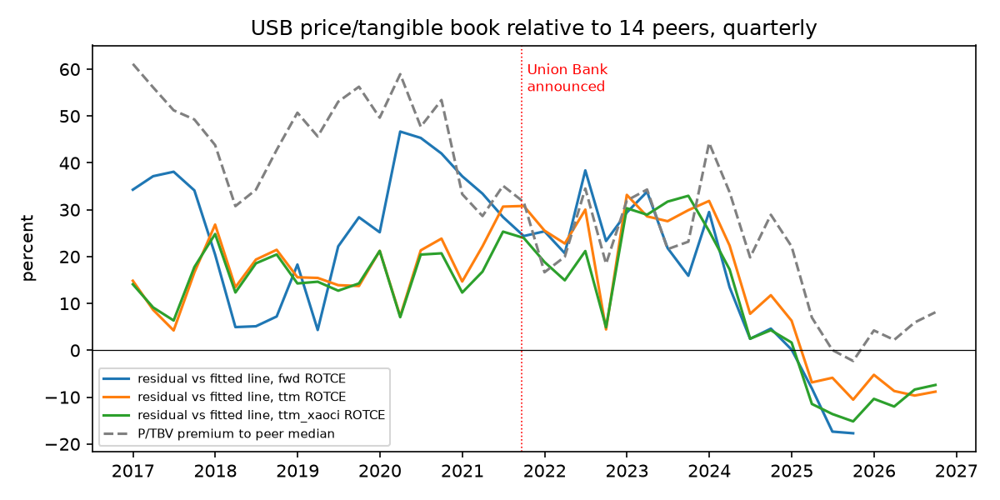

---

## 6. What we could not determine, and what would resolve it

**Conclusion** _(interp)_: The largest gaps are not about the bank's accounts, which are well documented, but about people and places: what its workers are paid, what its home-market deposits are, where its giving and tax-credit investment land, and what its own executives decided and why. The full ranked list, with routes, is `report/usb_open_questions.md`; records requests are drafted under `plan/outreach/`. The data added on 2026-11-11 closed two items from the first version of this list: whether the bank is now a Category II institution (it was not, on data through 2026Q3) and the FR Y-9C after 2021Q1 for the peer panel (obtained). Profile data also answered part of the jobs question. The ten most consequential open items now:

| # | Question | Why it matters | What would resolve it |
|---|---|---|---|
| 1 | Union Bank's stand-alone earnings since 2023, and what MUFG kept | Decides H14 (did the deal pay) | Company disclosure or interview; segment-level data |
| 2 | What the St. Paul Center and Main offices' deposits are | Decides whether "Twin Cities deposits" are local; H7, H16 | FDIC Summary of Deposits supervisory notes; bank treasury interview |
| 3 | Internal transfer pricing for segment deposits | Decides which business earns the deposit spread; D1 | Company disclosure; examiner materials are not public |
| 4 | Paid wages and worker outcomes by employer in Minnesota | Decides H2 locally and checks the profile-data headcount behind H3; the lead labor question | Census LEHD through a research data center; Minnesota UI wage records via a DEED agreement |
| 5 | Why anti-money-laundering alert caps went unexamined for years | Supervision and control culture (Q2) | OCC records request; interviews |
| 6 | Allowance scenario weights, overlays, and Level 3 liabilities | Accounting judgment (H13) | Earnings-call questions; Y-9C detail |
| 7 | Delivery of the $100 billion community plan; the $163 million 2023 foundation gift [V] | H9; Q7, Q8 | Progress reports; Form 990-PF Schedule B; national HMDA files 2018-2025 (the CRA files for 1996-2025 are now on disk) |
| 8 | Which tax credits the bank holds, by state, and its Minnesota income tax | H20 (Minnesota half) | Investor-relations question; county property records |
| 9 | Accretion from Union Bank after 2023 | Earnings quality | Earnings-call disclosure |
| 10 | Why Minneapolis stayed a headquarters city in 1997 and 2001 | H11 | The final 2001 joint proxy from the SEC; archives; interviews with merger-era participants |

**Hypotheses left undeterminable** (full table in Appendix C): H2, H5, H7d, H9, H10, H11, H14, H16, H20 (Minnesota half), H23, H25, H27. H3 and H22 left this list on 2026-11-11: H3 is not supported on total headcount, and H22 is consistent with the data but not shown. Several are undeterminable because the decisive data are restricted or unpublished, not because the analysis was not done; Appendix C says which.

**What public data cannot do** _(interp)_. No public source gives worker-level wages by employer (licensed profile data give employer headcount and modelled salaries, not paid wages), customer-level accounts, loan-level commercial data or supervisory ratings for a single bank (`plan/research_design.md` section 12). Findings in those areas rest on averages, samples with known selection problems and inference, and are labelled accordingly.

---

## 7. Appendices

### Appendix A. Methods

**Design.** The study follows `plan/research_design.md`. It works at four levels of observation: the firm; a panel of U.S. bank holding companies and banks; a local market panel of every bank, credit union and branch in the metro; and individual workers (without employer names). Questions about U.S. Bancorp alone are answered descriptively; causal designs use the panels, with U.S. Bank located within the estimated distribution. Each analysis was given a credibility grade before data were examined (C credible causal design, D descriptive, B bounded, N not answerable), and each hypothesis was dated 2026-11-10 with its decision rule before any data were pulled (`plan/vision.md` section 5; `plan/research_design.md` section 9).

**Peers.** The frozen sets in `plan/peers.yaml`: P-core (Capital One, PNC, Truist, Fifth Third, Huntington) and P-core-next (First Citizens, Citizens, M&T, KeyCorp, Regions). JPMorgan, Bank of America, Citigroup and Wells Fargo are reference lines, not part of medians. Some modules use wider sets; each memo states its set, and this report names the set where a result depends on it.

**Data.** SEC filings (10-K, 10-Q, 8-K, proxy statements, merger registration statements and correspondence); FFIEC Call Reports and FR Y-9C (to 2026Q3; the FFIEC files for 2021Q2 on were downloaded by hand on 2026-11-11); FDIC Summary of Deposits and institution histories; HMDA and CRA lending data (CRA small-business files 1996-2025); OCC CRA evaluations; enforcement orders (OCC, Federal Reserve, CFPB, DOJ, FinCEN, SEC, CFTC); CFPB complaints; Federal Reserve stress-test results and facility loan data; BLS QCEW and OEWS; Census QWI and LODES; Department of Labor visa wage filings and Form 5500; FEC, Senate LDA and Minnesota campaign-finance records; county property records; the foundation's Form 990-PF; market prices and 13F filings; archived web pages. Every file is registered in `sources.csv` with URL, retrieval date and checksum. Through the University of Minnesota's WRDS subscription the project also used CRSP daily stock returns, LSEG I/B/E/S analyst forecasts, FINRA TRACE bond trades, Mergent FISD bond ratings, LSEG 13F holdings and Revelio Labs workforce data. These are licensed. The report shows only statistics derived from them, cited as, for example, "CRSP via WRDS", and no rows of the licensed files; the pulls are described in `plan/wrds_pull_report.md`.

**Process.** Each module memo was written from scripts in `code/modules/<letter>/`, then reviewed adversarially by a separate session that recomputed a sample of figures and challenged the reasoning (`review/`). Memos were revised after review; this report uses the revised versions and notes where a review point was not carried into a memo. A discovery pass searched the data for anomalies (`plan/discoveries.md`); items it found that no memo absorbed are flagged as leads, not findings.

**This synthesis.** Eight digest workers read every memo and review and recorded each finding with its numbers as printed (`code/synthesis/digests/`); the synthesis was written from those digests and checked against the memos. Every number in this report was copied from a memo, and `code/synthesis/build_report_ledger.py` matches each to the memo's evidence-ledger row, preferring the memo cited in the same paragraph; five values whose memo rows were missing were traced to the script outputs directly (`code/synthesis/manual_rows.csv`). The 2026-11-11 update was made from the two change lists in `review/` and the updated memos, and the ledger was rebuilt with the same script. `automation/evidence_check.py` verifies that every number and quotation in the report has a ledger row, that every source id exists, and that every calculated value appears in its script's output.

**Where the memos disagree with one another** _(fact)_. The report uses: holding-company and bank-level returns both, labelled [C]; 68,520 employees for 2025 from the FY2025 10-K, not about 70,000 [S, A]; the corrected run-risk rank of 20th of 33 [Y], not 27th [J]; merger charges of $1,493 million [B], not $1,484 million [E], which differ by small quarterly classification; March 2023 peer medians of -19.0% [P] (nine peers) and -22.0% [O] (ten banks), both shown; second-worst rather than worst HTM loss at 2022Q4 [C] as corrected, against the uncorrected sentence in [BC]. Module B finds B3 (securities transfers timed to capital rules) not supported as a capital-timing hypothesis, while the deep dive calls it partly supported on timing; section 3.3 reports both, and H13 in this report follows the vision's definition rather than B's narrower smoothing test. Twin Cities office counts differ between [G] (bank-level series) and [T] (holding-company series) and are not reconciled. For shareholder returns the report now uses CRSP total returns [P] rather than the earlier price-only figures [P, E]. For holding-company CET1 against peers it uses the Y-9C [C], which supersedes the 10-K figures with incomplete peer coverage.

**Disclosure.** The collection, analysis and drafting were done by AI models under the owner's direction, as `plan/vision.md` requires the methods appendix to state. Every figure is traced to a public source or to code in this repository so that a reader can check it without trusting the drafting.

**Before publication** _(interp)_. The vision calls for a fairness and defamation review of the conduct, litigation and named-individual sections, and for the bank to be offered a chance to comment on factual claims. Neither has been done.

**Module key** (citations in square brackets):

| Tag | Memo | Tag | Memo |
|---|---|---|---|
| A | a_corporate_anatomy | N | n_business_lines |
| B | b_accounting | O | o_macro_systemic |
| BC | b_c_deep_dive | P | p_market_view |
| C | c_financial | Q | q_text_narrative |
| D | d_business_model | R | r_people_power |
| E | e_valuation | S | s_technology_ops |
| F | f_labor | T | t_physical_footprint |
| F-local | f_labor_local | U | u_political_economy |
| G | g_twin_cities_footprint | UB | x_union_bank_dossier |
| H | h_regulatory_legal | V | v_community_philanthropy |
| I | i_governance_pay | W | w_climate |
| J | j_strategy_risk | X | x_tax |
| K | k_history | Y | y_forward_models |
| L | l_products_pricing | Z | z_twin_cities_ecosystem |
| M | m_competition | | |

### Appendix B. Glossary and data dictionary

**Glossary.**

- **AOCI (accumulated other comprehensive income):** the part of equity that holds unrealized gains and losses on available-for-sale securities and some other items. Category III banks may exclude it from regulatory capital.
- **AFS / HTM:** available-for-sale securities (marked to market through AOCI) and held-to-maturity securities (carried at amortized cost).
- **Allowance for credit losses (ACL):** the reserve for expected loan losses. Under CECL (current expected credit loss accounting, adopted 1 January 2020) it covers lifetime expected losses.
- **Booking office:** a branch at which a bank records deposits that were not gathered there, typically at a head office.
- **Call Report / FR Y-9C:** quarterly regulatory financial reports filed by banks and by bank holding companies.
- **Category II / III:** tiers of the Federal Reserve's 2019 tailoring rules, set mainly by size; Category II starts at $700 billion of average assets.
- **CET1:** common equity tier 1 capital divided by risk-weighted assets, the main regulatory capital ratio.
- **CRA:** the Community Reinvestment Act, under which examiners rate a bank's service to its communities.
- **Deposit beta:** the share of a change in market interest rates passed through to deposit rates.
- **Efficiency ratio:** noninterest expense divided by revenue; lower means cheaper to run.
- **FTE:** full-time-equivalent employees.
- **HHI:** the Herfindahl-Hirschman index of market concentration (sum of squared percentage market shares); higher means more concentrated, and a monopoly scores ten thousand.
- **Labor share:** compensation divided by value added (here, compensation plus pre-provision profit).
- **NIB:** noninterest-bearing deposits.
- **NIM:** net interest margin, net interest income divided by earning assets.
- **ROTCE:** return on tangible common equity.
- **Stress capital buffer (SCB):** the Federal Reserve's firm-specific capital add-on set from stress-test results.
- **Tangible book value (TBV):** common equity less goodwill and other intangible assets.

**Data dictionary.** The full dictionary is `data/dictionary.md`. The datasets this report draws on most are: `data/fin_quarterly_bank.parquet` and `data/fin_quarterly_bhc.parquet` (Call Report and Y-9C panels); `data/fin_quarterly_sec.parquet` (SEC XBRL financials); `data/cra_sb_*` (CRA small-business lending, 1996-2025); `data/branches.parquet` and `data/branch_events.csv` (FDIC Summary of Deposits branch panel); `data/hmda_msa.parquet` (metro mortgage lending); `data/legal_events.csv` (enforcement and litigation); `data/complaints.parquet` (CFPB complaints); `data/headcount_comp_q.csv` and `data/pay_ratio_annual.csv` (employment and pay); `data/lca_wages.parquet` (visa wage filings); `data/timeline.csv` (dated events, owned by Module K); `data/q_scorecard_levels.csv` and `data/q_scorecard_growth.csv` (promises ledger); `data/r_network_edges.csv` (people and entity network); `data/segment_results_sec.csv`, which Module D found incomplete before 2021 and replaced with its own extraction.

### Appendix C. Hypothesis verdicts

Hypotheses H1-H15 were proposed in `plan/vision.md` and H16-H27 in `plan/research_design.md`, all dated 2026-11-10 before any data were examined. Verdicts are the reviewed memos' own unless marked "synthesis reading" (where a memo gave none).

| H | Short statement | Verdict | Basis |
|---|---|---|---|
| H1 | Efficiency gains came more from pay and headcount restraint than technology | Neither supported nor refuted | Compensation is 64% of the relative improvement, but non-labor expense also fell relative to peers, failing the second condition [F] |
| H2 | Profit passes through to pay more weakly here than at peers | Undeterminable | USB's slope near mid-panel; permutation tests not significant [F] |
| H3 | Twin Cities share of employment has fallen, faster at each acquisition | Not supported on total headcount; within-job share fell | Profile data (Revelio via WRDS): share 16.9% (2010) to 19.6% (2020), a mechanical step down with Union Bank, 16.6% (2025) [F-local] |
| H4 | Local banking employers concentrated enough to hold wages down | Not supported | National teller estimate near zero; metro branch market unconcentrated, though two employers hold most metro bank jobs on profile data [F-local] |
| H5 | 2023 noncompete ban raised finance pay or mobility | Undeterminable | Test cannot detect plausible effects, also when rebuilt on employer profile data [F-local] |
| H6 | Automation-exposed occupations already shrinking | Weakly supported at industry level only; no shift detected at the firm | Firm half tested crudely on profile-data hires [F] |
| H7a | Lower, less rate-sensitive deposit costs | Held in 2007-2009; no longer | [M] |
| H7b | Advantage reflects market power, not mix | Not supported (low power) | [M] |
| H7c | Home market is where the advantage is earned | Not supported by structure | [M] |
| H7d | Home deposits fund national lending | Undeterminable | [M] |
| H8 | Closures fall on lower-income and minority neighborhoods; small-business lending falls after | Weakened; small-business share fell faster than deposit share (G-c supported); lending after closures untestable (county totals) | [G] |
| H9 | Merger commitments did not change lending behavior | Undeterminable | Plan period not over; national HMDA files not on disk, and the CRA files that arrived on 2026-11-11 have not been used for this test [V] |
| H10 | A headquarters delivers measurable local benefits | Not detected for bank employment; untested otherwise | [Z] |
| H11 | Twin Cities stayed a headquarters city for structural reasons | Undeterminable from documents held | [K, Z] |
| H12 | Above-peer returns from fees and cost discipline | Consistent for 2010-2021 (synthesis reading); moot after 2022 | [D, C] |
| H13 | Conservative reputation holds on reserves against later losses | Neither supported nor rejected | Coverage below median, not bottom quartile [B, BC] |
| H14 | Union Bank cost shareholders more than it returned | Undeterminable, leaning rejected | [E, UB] |
| H15 | Conduct failures trace to incentive design visible in proxies | Weakened | [I, H] |
| H16 | Deposit cost advantage comes from trust, escrow and payments balances | Undeterminable | Balances not disclosed [C, BC] |
| H17 | Post-deal headcount fall larger than typical large merger | Not supported | [F, UB] |
| H18 | Pay set on a national scale | Not supported for visa-filed roles | [F] |
| H19 | Return gap and valuation premium narrowed, return gap first | Consistent, not formally tested | [C, E] |
| H20 | Tax credits a larger share of profit than disclosed; projects mostly outside Minnesota | First half supported on the tax-reduction measure; second half untestable | [X, N] |
| H21 | Local banks lend more per local deposit and close fewer branches | Split: fewer closures supported; more lending not supported once size is controlled | [Z] |
| H22 | Asset growth managed around the regulatory threshold | Consistent, not shown; size test settled (not crossed through 2026Q3) | Y-9C regulatory measure below $700 billion in every quarter; growth slowed near the line, with other explanations [BC] |
| H23 | Promises met at different rates by constituency | Undeterminable on comparable evidence | Scorecard [Q] |
| H24 | Interchange cap costs passed to workers | Not supported (weak test) | [F] |
| H25 | Complaint rate below peer median | Mixed by product; undeterminable as stated (synthesis reading) | [L, H] |
| H26 | Local-headquarters deposit share fell in steps; credit unions rising | Supported on the ex-booking measure | [Z] |
| H27 | Non-solicitation clauses make the noncompete ban irrelevant | Undeterminable | [F, F-local] |

### Appendix D. Sources

The master list of every source used anywhere in the project is `sources.csv` (one row per source: id, title, publisher, URL, date retrieved, local path, checksum). The sources behind this report, meaning every source cited in its evidence ledger or text plus every source cited by the module memos it draws on, are listed with titles, URLs and the memos citing them in `report/usb_report_sources.csv`, generated by `code/synthesis/list_report_sources.py`. Each module memo's evidence ledger (`modules/<memo>.evidence.csv`) gives the page, table or field for every figure.

